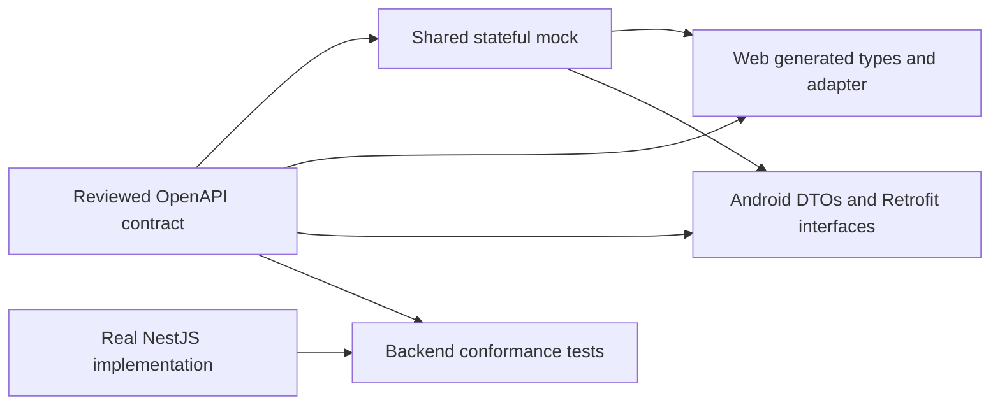

# API_CONTRACT_V1.md — Blogpost REST API contract plan

Approved through interview on 25 October 2026.

**Status:** approved implementation plan and wire-design baseline. This document does not claim that an OpenAPI package, mock server, generated clients, or backend has been implemented or released. Contract release `1.0.0` becomes frozen only after the acceptance gates below pass.

[BUILD_VARIANTS_PLAN.md](BUILD_VARIANTS_PLAN.md) governs local Development, isolated Staging/Production, and operational provenance. All environments retain this envelope, the five required metadata headers, authentication/permission rules, and version/idempotency semantics. No required environment header is added; environment claims from clients never authorize an operation.

Related plans: [backend](BLOGPOST_BACKEND_PLAN.md), [Next.js web](BLOGPOST_FRONTEND_WEB_PLAN.md), [native Android](BLOGPOST_FRONTEND_ANDROID_PLAN.md). Deployment context: [backend guide](BACKEND_DEPLOYMENT_GUIDE.md) and [web guide](FRONTEND_WEB_DEPLOYMENT_GUIDE.md).

## 1. Summary and authority

Define and freeze the complete `/v1` contract before frontend implementation depends on backend behavior. Web and Android develop against the same versioned schemas, examples, and stateful mock.

This document is authoritative for HTTP requests, response envelopes, DTOs, errors, concurrency, idempotency, and compatibility. Existing product, authorization, and editorial decisions remain unchanged. Where an older plan's wire example conflicts with this document, this document takes precedence.

The contract covers backend `/v1` operations and their equivalent proxied Web responses. Independent Web bootstrap/configuration routes and infrastructure health routes are not backend `/v1` operations.

| Earlier convention                                      | Contract decision                                                           |
| ------------------------------------------------------- | --------------------------------------------------------------------------- |
| Separate success and Problem Details responses          | One JSON envelope for success and errors                                    |
| `requestId` as the primary client diagnostic identifier | `traceId`, also returned in `X-Trace-ID`                                    |
| Post-version ETag and `If-Match`                        | `X-Expected-Version` and `X-Resource-Version`                               |
| Uploads implicitly included in post mutations           | Staged uploads are independent media resources                              |
| Shorter compatibility minimum                           | Previous API major supported for at least 12 months, with retirement notice |

The version-header change avoids treating a stable post version as a strong validator for an envelope whose timestamp and trace change on every response. [HTTP validator semantics](https://www.rfc-editor.org/rfc/rfc9110.html#section-8.8.1)

Baseline assumptions:

- No deployed wire contract needs migration; the workspace contains plans.
- Backend, web, and Android remain separate repositories.
- Google Identity Platform authentication, role permissions, local drafts, explicit synchronization, private media, and editorial workflows remain as previously agreed.
- English remains the initial UI/content language.
- The deliverable here is a complete contract implementation plan. Executable contract tooling is a subsequent development task, not an unreported artifact of writing this document.

## 2. Shared transport contract

### 2.1 Version terminology

| Concept               | Example            | Purpose                              |
| --------------------- | ------------------ | ------------------------------------ |
| API major             | `/v1`              | Breaking wire-contract boundary      |
| Contract release      | `1.0.0`            | Versioned schema and fixture package |
| OpenAPI specification | `3.1.2`            | Schema-description format            |
| Application release   | `1.2.0+android.42` | Client diagnostics                   |
| Device OS release     | `16`               | Device diagnostics                   |
| Resource version      | `8`                | Optimistic concurrency               |
| Markdown contract     | `1`                | Supported content syntax             |

Use OpenAPI **3.1.2** for the initial machine-readable contract because the selected tooling supports the 3.1 family. The OpenAPI format version does not determine the API's `/v1` namespace. [OpenAPI 3.1.2](https://spec.openapis.org/oas/v3.1.2.html)

### 2.2 Response envelope

Every application JSON response has these eight fields:

```json
{
  "timestamp": "2026-10-25T08:20:30.123Z",
  "responseKey": "SUCCESS",
  "statusCode": 200,
  "traceId": "4bf92f3577b34da6a3ce929d0e0e4736",
  "message": {
    "title": "Posts loaded",
    "descriptions": "The published post list was loaded."
  },
  "data": [],
  "error": null,
  "meta": {
    "contractVersion": "1.0.0",
    "pagination": {
      "kind": "CURSOR",
      "pageSize": 20,
      "hasMore": false,
      "nextCursor": null
    },
    "idempotency": null
  }
}
```

| Field                  | Required behavior                                                                  |
| ---------------------- | ---------------------------------------------------------------------------------- |
| `timestamp`            | Server response-generation time, RFC 3339 UTC with millisecond precision           |
| `responseKey`          | Exactly `SUCCESS` or `ERROR`                                                       |
| `statusCode`           | Integer equal to the actual HTTP status                                            |
| `traceId`              | Current distributed-trace identifier; 32 lowercase hexadecimal characters          |
| `message.title`        | Safe English diagnostic/fallback text                                              |
| `message.descriptions` | One string; retain the requested plural field name                                 |
| `data`                 | Endpoint-specific object or array on success; `null` on error                      |
| `error`                | `null` on success; structured error on failure                                     |
| `meta`                 | Object containing contract version and nullable pagination/idempotency information |

Rules:

- Use actual HTTP statuses; do not return HTTP `200` for application errors.
- Successful empty collections return `data: []`.
- Successful mutations return a resource or receipt rather than JSON `204`.
- Do not switch `data` between an array and an object for the same operation.
- Clients depend on status and machine codes, never message wording.
- Web and Android own their localized UI copy.
- Do not serialize ORM entities directly into the envelope.
- Do not echo request headers, credentials, or rejected secret values.
- `meta.pagination` is null for non-collection responses and errors. `meta.idempotency` is null when no operation record applies.
- JSON object property order is not meaningful. All eight envelope fields remain required.

When applicable, `meta.idempotency` is `{ "replayed": false, "expiresAt": "2026-10-26T08:20:30.123Z" }`. The replay flag changes to true for a completed operation replay.

### 2.3 Binary and bodyless exceptions

| Response                     | Behavior                                                                  |
| ---------------------------- | ------------------------------------------------------------------------- |
| Successful image delivery    | Raw bytes with the correct image content type                             |
| Image-delivery failure       | Normal JSON error envelope                                                |
| `HEAD`                       | Applicable status/headers from `GET`, without a body, including on errors |
| CORS preflight               | Bodyless response; normally `204`                                         |
| Infrastructure health probes | Small health payload outside the application envelope                     |

Application JSON uses `Content-Type: application/json`. Public content and media retain `Cache-Control: no-store`. Do not introduce JSON `304` responses or a public image cache. API slug lookup returns a wrapped resolution descriptor; Next.js performs any public-site `308` redirect itself.

### 2.4 Required client metadata headers

Every Web-to-backend and Android-to-backend application request sends all five headers, including anonymous reads, uploads, and media requests.

| Header             | Meaning                                        | Validation/default                                                                           |
| ------------------ | ---------------------------------------------- | -------------------------------------------------------------------------------------------- |
| `X-Device-ID`      | Random installation/browser-profile identifier | Canonical lowercase UUID v4; never hardware-derived                                          |
| `X-Device-OS`      | Underlying operating system                    | Canonical names such as `ANDROID`, `IOS`, `WINDOWS`, `MACOS`, `LINUX`, `CHROMEOS`, `UNKNOWN` |
| `X-Device-Version` | OS release                                     | Nonempty bounded string, maximum 64 characters; `unknown` when unavailable                   |
| `X-App-Version`    | Calling application release                    | Semantic version, maximum 64 characters; build metadata permitted                            |
| `X-App-Language`   | Selected application UI language               | One valid BCP 47 tag, maximum 64 characters                                                  |

Header names are case-insensitive. Reject duplicate or malformed values rather than silently combining them. `X-Device-OS` accepts 1–32-character uppercase identifiers matching `[A-Z][A-Z0-9_]{0,31}`, including future identifiers; it is not a closed domain enum. Reject control characters, blank values, and comma-separated multiple values. OS-version values are printable ASCII, not arbitrary diagnostic dumps.

```http
X-Device-ID: 8d5ca46a-7f59-4f64-9d91-fedc41b59e7a
X-Device-OS: ANDROID
X-Device-Version: 16
X-App-Version: 1.0.0+android.1
X-App-Language: en
```

Additional rules:

- Device ID persists across sign-ins until reset, reinstall, or site-data clearing.
- It is not an authentication credential or a trusted security signal.
- Android generates an app identifier; do not use IMEI, advertising ID, or a hardware fingerprint. Exclude the identifier from backup restoration into another installation.
- Web uses a first-party UUID cookie established before server rendering.
- When persistent browser storage is unavailable, use an ephemeral random identifier; do not fingerprint or block public reading.
- Unsupported but valid language tags are accepted and do not filter article content.
- Diagnostic messages remain English in v1; clients localize their own copy.
- Unknown OS releases use `unknown`; clients must not invent precise values.
- Hash device identifiers in retained diagnostic logs. Do not use these headers to introduce analytics or authorize requests.

Only infrastructure probes and CORS preflight are exempt. Missing or malformed metadata returns `400 INVALID_CLIENT_METADATA` with field-level header issues.

### 2.5 Web propagation rules

Next.js supplies visitor metadata for server-rendered public pages, metadata generation, BFF authoring calls, and public/private image proxy calls.

Establish the device cookie before rendering and put the resolved context in request-scoped server state. Next.js Proxy supports modifying incoming request headers and response cookies before request completion. [Next.js Proxy](https://nextjs.org/docs/app/api-reference/file-conventions/proxy)

Use one metadata factory across server and browser transport adapters:

- Cookie supplies device ID; OS information is best effort and unavailable versions remain `unknown`.
- SSR uses the deployed web release. Browser calls preserve a valid calling bundle version so older open tabs remain diagnosable.
- BFF handlers sanitize incoming metadata and construct backend headers explicitly.
- Browser image elements need no custom-header capability: the Next.js media route supplies headers on its backend request.
- Never forward visitor credentials or metadata to arbitrary external hosts.
- A missing/malformed device cookie is regenerated before rendering. It does not authorize access or alter membership.

### 2.6 Authentication and tracing headers

| Caller                   | Credential                                                |
| ------------------------ | --------------------------------------------------------- |
| Android                  | `Authorization: Bearer <IdentityPlatformIdToken>`         |
| Next.js server proxy     | `X-Blogpost-Web-Session: <verified-session-cookie-value>` |
| Anonymous public request | No application credential                                 |

Reject both credential schemes in one request. Never accept raw Google OAuth ID tokens as Blogpost credentials. Web session values remain in Secure, HttpOnly cookies on the web origin. Backend authorization always checks current SQL membership.

Use W3C `traceparent` between Next.js and backend. Generate context when none is valid; return `X-Trace-ID` matching the envelope. Trace context is diagnostic and never establishes identity. [W3C Trace Context](https://www.w3.org/TR/trace-context/)

Return `X-API-Contract-Version`; return `X-Resource-Version` for successful single mutable-resource responses, `Location` on creation, and `Retry-After` when applicable. Public published snapshots do not expose private workspace versions.

CORS explicitly permits required metadata, credential, version, idempotency, and tracing headers. Expose relevant response headers to approved origins. Do not broaden CORS for temporary test hosts.

### 2.7 Structured errors

```json
{
  "timestamp": "2026-10-25T08:21:00.000Z",
  "responseKey": "ERROR",
  "statusCode": 412,
  "traceId": "4bf92f3577b34da6a3ce929d0e0e4736",
  "message": {
    "title": "Draft changed",
    "descriptions": "Fetch the current revision before resolving this conflict."
  },
  "data": null,
  "error": {
    "code": "VERSION_CONFLICT",
    "fieldErrors": [],
    "context": {
      "resourceType": "POST",
      "resourceId": "10000000-0000-4000-8000-000000000001",
      "expectedVersion": 7,
      "currentVersion": 8,
      "currentRevisionId": "20000000-0000-4000-8000-000000000008",
      "resourcePath": "/v1/posts/10000000-0000-4000-8000-000000000001"
    }
  },
  "meta": {
    "contractVersion": "1.0.0",
    "pagination": null,
    "idempotency": null
  }
}
```

Each field issue contains:

```json
{
  "location": "body",
  "field": "/tagIds/0",
  "code": "UNKNOWN_REFERENCE",
  "params": {}
}
```

`location` is `header`, `path`, `query`, or `body`. `field` uses JSON Pointer relative to that location. `error` always contains `code`, an array `fieldErrors`, and nullable `context`.

Collect up to 50 safely determinable field issues in deterministic location/path order. Authentication, malformed JSON, body-size limits, and unsafe decoding fail early. Never echo tokens, passwords, rejected Markdown, or image bytes. Indicate truncation in validation context if more than 50 issues exist.

| HTTP status | Initial machine-code families                                                                                                                                                                       |
| ----------- | --------------------------------------------------------------------------------------------------------------------------------------------------------------------------------------------------- |
| `400`       | `INVALID_CLIENT_METADATA`, `MALFORMED_JSON`, `INVALID_CURSOR`, `INVALID_IDEMPOTENCY_KEY`, `INVALID_EXPECTED_VERSION`, `AMBIGUOUS_CREDENTIALS`                                                       |
| `401`       | `AUTHENTICATION_REQUIRED`, `INVALID_CREDENTIAL`, `AUTHENTICATION_EXPIRED`                                                                                                                           |
| `403`       | `INSUFFICIENT_PERMISSION`, `ACCESS_REVOKED`, `INVITATION_ACCOUNT_MISMATCH`, `CSRF_VALIDATION_FAILED`                                                                                                |
| `404`       | `RESOURCE_NOT_FOUND`, `INVITATION_INVALID`                                                                                                                                                          |
| `405`       | `METHOD_NOT_ALLOWED`, with `Allow`                                                                                                                                                                  |
| `409`       | `WORKFLOW_CONFLICT`, `SLUG_CONFLICT`, `LAST_ADMIN_REQUIRED`, `MEMBER_ALREADY_EXISTS`, `CLIENT_DRAFT_ALREADY_EXISTS`, `IDEMPOTENCY_KEY_REUSED`, `IDEMPOTENCY_IN_PROGRESS`, `RESOURCE_QUOTA_EXCEEDED` |
| `410`       | `INVITATION_EXPIRED`, `INVITATION_USED`, `INVITATION_REVOKED`, `API_VERSION_RETIRED`                                                                                                                |
| `412`       | `VERSION_CONFLICT`                                                                                                                                                                                  |
| `413`       | `PAYLOAD_TOO_LARGE`, `UPLOAD_TOO_LARGE`                                                                                                                                                             |
| `415`       | `UNSUPPORTED_MEDIA_TYPE`                                                                                                                                                                            |
| `422`       | `VALIDATION_FAILED`, `MARKDOWN_UNSUPPORTED`, `SEARCH_QUERY_NOT_SEARCHABLE`                                                                                                                          |
| `428`       | `EXPECTED_VERSION_REQUIRED`                                                                                                                                                                         |
| `429`       | `RATE_LIMITED`                                                                                                                                                                                      |
| `500`       | `INTERNAL_ERROR`                                                                                                                                                                                    |
| `503`       | `DEPENDENCY_UNAVAILABLE`                                                                                                                                                                            |
| `504`       | `UPSTREAM_TIMEOUT`                                                                                                                                                                                  |

Error codes are extensible strings. Unknown codes receive safe status-based handling; clients must not crash or automatically retry an unknown write error. Full draft snapshots never belong in conflict context. Fetch the authorized current resource separately.

An inaccessible private resource returns generic `404`, not another author's title/current version. Public unavailable content does not disclose whether it was unknown, withdrawn, or trashed.

Uncontrolled network/proxy/platform failures may have no envelope. Treat malformed/non-JSON responses as transport failures. Next.js normalizes failures it controls into this envelope and never displays raw upstream HTML. A correctly wrapped backend response must not be wrapped a second time.

### 2.8 Optimistic concurrency

```http
X-Expected-Version: 7
Idempotency-Key: 83c9a1ca-6d20-48c5-8476-bb6a60677377
```

Successful responses include the committed version in `data.version` and `X-Resource-Version`.

- Missing version: `428`. Malformed version: `400`. Stale version: `412` without mutation.
- Versions are positive integers from 1 to 2,147,483,647. Reject overflow rather than rounding/coercing it.
- Draft changes, review transitions, publication, withdrawal, slug/ownership changes, trash, and restore advance the post version.
- Unchanged draft sync/PATCH is a no-op retaining its version.
- Staged uploads do not advance the post version.
- Revision IDs identify immutable snapshots, not concurrency versions.
- Clients do not adopt a conflict's current version without fetching its state.
- Use the convention for member, invitation-management, category, and tag mutations too.
- A collection has no single resource-version response header. Error responses expose current versions through authorized error context, not an automatically adoptable success header.

### 2.9 Idempotency and uncertain outcomes

Require UUID v4 `Idempotency-Key` for application mutations, including draft synchronization. Exempt read-only availability POST and web-session exchange.

Scope records by authenticated UID, method, path, and key. Fingerprint semantic input, including expected version and upload bytes; exclude credentials, trace context, and device metadata. JSON object-key ordering does not change the fingerprint; meaningful array ordering does.

Processing order:

1. Establish tracing and transport limits.
2. Validate metadata and credential syntax.
3. Authenticate and verify current permission/resource visibility.
4. Validate request shape and idempotency input.
5. Return a matching completed operation before checking the resource's latest version.
6. Otherwise enforce version/workflow rules.
7. Commit mutation and operation result atomically where SQL is involved.

Completed successful results remain replayable for 24 hours. On replay, return the original domain result/status/version, current response timestamp/trace, and `meta.idempotency.replayed: true`. Clients fetch current state before treating that result as the latest snapshot.

An in-progress operation returns `409 IDEMPOTENCY_IN_PROGRESS` with `Retry-After`. Same completed key with different semantic input returns `409 IDEMPOTENCY_KEY_REUSED`. Definitively rejected pre-commit requests are not stored as successful results. Upload processing outside SQL uses a bounded lease/reconciliation mechanism so a lost response cannot create duplicate ready assets.

Do not automatically retry corrected input under an old operation identity. A timeout is not proof that a write failed. A credential refresh preserves the original input/key/version.

**Offline creation recovery:** every create-post request includes persistent `clientDraftId`, unique per creating member while the post exists. Provide authorized lookup by that identifier. After replay expiry, reconcile using it or current workflow/history; never silently recreate an unresolved old draft when lookup is unavailable/inconclusive. Keep client-draft and server IDs after successful creation.

**Invitation-secret exception:** create/reissue initially returns the new link; store only its token hash. Replay returns the original invitation receipt with the following nonrecoverable secret fields:

```json
{
  "inviteUrl": null,
  "linkAvailable": false
}
```

This remains a successful, replay-marked result. Admin explicitly reissues a replacement and revokes the prior invitation. Do not introduce plaintext/encrypted invitation-link replay storage. Web-session exchange is excluded from replay storage entirely.

## 3. Resource schemas and endpoint catalog

### 3.1 Common schema rules

- JSON properties use `camelCase`; public resource IDs are UUIDs, not identity-provider UIDs.
- Timestamps use RFC 3339 UTC; arrays are never null.
- Nullable fields explicitly allow null; omission has separately documented meaning.
- Requests reject unknown body/query properties unless designated extensible. Responses permit additive properties; clients ignore them.
- Request and response DTOs are separate. Required response fields cannot disappear or become nullable within v1.
- PATCH omission preserves the value; explicit null clears only a documented nullable input. PATCH must contain at least one supported field.
- Publish-time validation may be stricter than draft-save validation without making valid incomplete drafts impossible to save.

Freeze these critical enums throughout `/v1`:

```text
Role: AUTHOR | EDITOR | ADMIN
PublicationState: NEVER_PUBLISHED | PUBLISHED | WITHDRAWN
WorkflowState: DRAFT | IN_REVIEW | CHANGES_REQUESTED | CLEAN
```

Clients still implement unknown-value fallback disabling unsafe editing. Capabilities, allowed actions, and error codes are extensible strings; unknown actions are not displayed/executed.

### 3.2 DTO catalog

| DTO                     | Required content                                                                                                               |
| ----------------------- | ------------------------------------------------------------------------------------------------------------------------------ |
| `AuthorSummary`         | `id`, `handle`, `displayName`                                                                                                  |
| `PublicAuthor`          | Author summary plus `bio`                                                                                                      |
| `Taxon`                 | `id`, `name`, `slug`, `active`                                                                                                 |
| `ImageReference`        | `mediaId`, `altText`, `decorative`, dimensions, delivery variants                                                              |
| `PublicPostSummary`     | Post identity/content summary, author/taxonomy, nullable cover, published revision, public timestamps                          |
| `PublicPost`            | Summary plus Markdown, Markdown-contract version, referenced-media metadata                                                    |
| `RevisionSummary`       | Revision/post IDs, number, title, creator, creation time                                                                       |
| `Revision`              | Immutable identity/provenance, credited author, full content, media, nullable restoration source                               |
| `WorkspacePostSummary`  | Post/client-draft IDs, owner, nullable slug, states/version, revision pointers, timestamps, trash/purge dates, allowed actions |
| `WorkspacePost`         | Workspace summary plus working/published snapshots and review information                                                      |
| `ReviewEvent`           | ID, post/revision IDs, action, actor, timestamp, nullable feedback                                                             |
| `Me`                    | Member ID, private email, profile, role, active status, version                                                                |
| `AdminMember`           | Me plus creation/update timestamps                                                                                             |
| `ManagedTaxon`          | Taxon plus version, usage counts, creation/update timestamps                                                                   |
| `Invitation`            | ID, email/role/status/version, issuer, expiry, acceptance/revocation timestamps                                                |
| `InvitationIssueResult` | Invitation receipt, nullable `inviteUrl`, `linkAvailable`                                                                      |
| `MediaAsset`            | ID, post, readiness, MIME/dimensions, processed variants, creation/unattached expiry                                           |
| `AvailabilityItem`      | Post ID, available flag, nullable current published revision ID                                                                |
| `SlugResolution`        | Resolution, canonical slug/path, nullable public post                                                                          |
| `AuditEvent`            | ID, actor, action, subject type/ID, time, bounded safe change metadata                                                         |
| `ApiMeta`               | API/contract/Markdown versions, build identifier, features, limits, client recommendations, lifecycle                          |

Public dates/revision IDs reflect published state only. Private edits do not alter public `updatedAt` or expose workspace version. Workspace collections contain summaries, not full Markdown.

### 3.3 Draft input and validation

| `DraftContentInput` field | Type/rule                                                   |
| ------------------------- | ----------------------------------------------------------- |
| `title`                   | Required string; 0–160 Unicode code points                  |
| `summary`                 | Required string; 0–320 code points                          |
| `markdown`                | Required string; maximum 131,072 UTF-8 bytes                |
| `categoryId`              | Required UUID or null                                       |
| `tagIds`                  | Required array; 0–5 unique UUIDs                            |
| `coverMediaId`            | Required UUID or null                                       |
| `markdownContractVersion` | Optional; default 1; only 1 accepted in v1                  |
| `coverAltText`            | Optional nullable string; required for an informative cover |
| `coverDecorative`         | Optional boolean; default false                             |

Drafts may be incomplete. Publication requires nonblank title, summary/body, one active category, valid active tags, supported Markdown, and ready authorized media. A decorative cover has empty alt text. No cover means null cover alt text and false decorative flag.

| Input              | Limit                                                              |
| ------------------ | ------------------------------------------------------------------ |
| Display name       | 1–80 code points                                                   |
| Bio                | 0–500 code points                                                  |
| Rejection feedback | 1–2,000 code points                                                |
| Alt text           | Up to 300 code points                                              |
| Search query       | Up to 200 code points                                              |
| Slug               | Lowercase ASCII words separated by hyphens; maximum 120 characters |
| JSON body          | Maximum 1 MiB                                                      |
| Image file         | Maximum 5 MiB and 12,000,000 decoded pixels                        |
| Multipart body     | Maximum 6 MiB, one file                                            |
| Availability batch | Maximum 50 unique post IDs                                         |

Use identical Unicode/UTF-8 counting in client fixtures/backend validation. PATCH profile omission leaves bio unchanged; null clears it to canonical empty string. Display name is not nullable.

Draft PUT replaces the declared v1 editable fields. Future independently editable attributes require an additional explicit mutation interface; an older full-draft save must never erase fields it cannot understand. Preserve cover metadata on a save that leaves the same cover selected but omits optional cover presentation fields; on creation the documented defaults apply. Clearing/changing a cover requires its corresponding presentation data or an explicit decorative choice.

### 3.4 Pagination and filtering

**Cursor collections:** public feed, workspace, revisions, review events, members, invitations, audit. Default page size 20, maximum 50. Feed orders by first publication descending then ID; workspace by updated time descending then ID. Event/history ordering uses descending event time/revision number with stable ID tie-breaking.

Cursors are opaque, bounded to 2,048 characters, filter/order/page-size-bound, and expire after 24 hours. Invalid/expired/mismatched cursors return `400 INVALID_CURSOR`. Concurrent publication is not a frozen snapshot; deduplicate by ID. Query names are `cursor` and `pageSize`; omit cursor on the first page.

**Page collections:** ranked search and taxonomy. One-based `page`; search defaults to 20, taxonomy to 50; maximum `pageSize` 50. Search exposes at most the first 1,000 matches and marks truncation when further matches require narrowing the query. `totalItems` reports matching items; `totalPages` and `hasMore` describe the accessible result window.

```json
{
  "kind": "CURSOR",
  "pageSize": 20,
  "hasMore": true,
  "nextCursor": "opaque-value"
}
```

```json
{
  "kind": "PAGE",
  "page": 1,
  "pageSize": 20,
  "totalItems": 48,
  "totalPages": 3,
  "hasMore": true,
  "truncated": false
}
```

Public filters are `categoryId`, `authorId`, and repeated `tagIds` parameters using AND semantics. Search ranks title/summary/published body, never drafts. Search requires nonblank `q`; non-indexable queries return `422 SEARCH_QUERY_NOT_SEARCHABLE`. Unsupported query properties return validation errors, not silently ignored filters.

### 3.5 Endpoints

`V` means `X-Expected-Version`; `K` means `Idempotency-Key`. All rows require the five metadata headers. Default JSON success is `200`; authentication/ownership visibility is checked before exposing private details. Empty transition bodies are `{}`. Stable operation IDs below are part of the generator-facing contract.

#### Public reading

| Method/path                                               | Input                 | Success data          | Operation ID                  |
| --------------------------------------------------------- | --------------------- | --------------------- | ----------------------------- |
| `GET /v1/meta`                                            | None                  | `ApiMeta`             | `getApiMeta`                  |
| `GET /v1/public/posts`                                    | Cursor/public filters | `PublicPostSummary[]` | `listPublicPosts`             |
| `GET /v1/public/posts/{postId}`                           | UUID                  | `PublicPost`          | `getPublicPost`               |
| `GET /v1/public/posts/by-slug/{slug}`                     | Slug                  | `SlugResolution`      | `resolvePublicPostSlug`       |
| `GET /v1/public/search`                                   | q/page/public filters | `PublicPostSummary[]` | `searchPublicPosts`           |
| `GET /v1/public/categories`                               | Page                  | `Taxon[]`             | `listPublicCategories`        |
| `GET /v1/public/tags`                                     | Page                  | `Taxon[]`             | `listPublicTags`              |
| `GET /v1/public/authors/{handle}`                         | Handle                | `PublicAuthor`        | `getPublicAuthor`             |
| `POST /v1/public/posts/availability`                      | `{postIds}`           | `AvailabilityItem[]`  | `checkPublicPostAvailability` |
| `GET /v1/public/posts/{postId}/media/{mediaId}/{variant}` | Variant               | Raw image             | `getPublicPostMedia`          |

Slug resolution is `CANONICAL` with the post or `REDIRECT` with its canonical relative path. Withdrawn targets return 404. No private working revision is returned through slug resolution.

Availability results preserve request order. Unknown/withdrawn/trashed IDs all return unavailable without disclosing private state. Dependency failure errors the whole request; never manufacture unavailable flags that would delete valid offline copies.

Public taxonomy includes active entries plus archived entries still referenced by public posts. Staff selectors permit only active entries for new publication. Taxonomy names/slugs are public vocabulary, not draft content.

#### Identity/profile

| Method/path                   | Access/input                        | Success data | Operation ID       |
| ----------------------------- | ----------------------------------- | ------------ | ------------------ |
| `POST /v1/auth/web-session`   | Recent token in body; no K          | `WebSession` | `createWebSession` |
| `GET /v1/me`                  | Active member                       | `Me`         | `getMe`            |
| `PATCH /v1/me`                | Active member; V,K; displayName/bio | `Me`         | `updateMe`         |
| `POST /v1/invitations/accept` | Verified identity; K; `{token}`     | `Me`         | `acceptInvitation` |

Session exchange input is `{idToken}` and checks recent authentication within five minutes. `WebSession` is server-proxy-only and contains `sessionCookie`, `expiresAt`, and `member`. Never expose it to browser JSON/storage. The session lasts five days.

Invitation acceptance does not require prior membership, but requires exact invited verified email and atomically consumes the token. Web logout stays a CSRF-protected web operation clearing session/staff-local storage.

#### Draft/editorial

| Method/path                                        | Access/input                               | Success data                | Operation ID             |
| -------------------------------------------------- | ------------------------------------------ | --------------------------- | ------------------------ |
| `GET /v1/posts`                                    | Staff; cursor/scope/state/trash filters    | `WorkspacePostSummary[]`    | `listWorkspacePosts`     |
| `POST /v1/posts`                                   | Staff; K; `{clientDraftId,draft}`          | `201 WorkspacePost`         | `createPost`             |
| `GET /v1/posts/by-client-draft-id/{clientDraftId}` | Authorized creator lookup                  | `WorkspacePost`             | `getPostByClientDraftId` |
| `GET /v1/posts/{postId}`                           | Owner/editor/admin                         | `WorkspacePost`             | `getWorkspacePost`       |
| `PUT /v1/posts/{postId}/draft`                     | Owner/editor/admin; V,K; full draft        | `WorkspacePost`             | `savePostDraft`          |
| `POST /v1/posts/{postId}/submit`                   | Owner/editor/admin; V,K; `{revisionId}`    | `WorkspacePost`             | `submitPostForReview`    |
| `POST /v1/posts/{postId}/withdraw-review`          | Owner/editor/admin; V,K; `{}`              | `WorkspacePost`             | `withdrawPostReview`     |
| `POST /v1/posts/{postId}/reject`                   | Editor/admin; V,K; `{revisionId,feedback}` | `WorkspacePost`             | `rejectPostRevision`     |
| `POST /v1/posts/{postId}/publish`                  | Editor/admin; V,K; `{revisionId}`          | `WorkspacePost`             | `publishPostRevision`    |
| `POST /v1/posts/{postId}/unpublish`                | Editor/admin; V,K; `{}`                    | `WorkspacePost`             | `unpublishPost`          |
| `GET /v1/posts/{postId}/revisions`                 | Authorized staff; cursor                   | `RevisionSummary[]`         | `listPostRevisions`      |
| `GET /v1/posts/{postId}/revisions/{revisionId}`    | Authorized staff                           | `Revision`                  | `getPostRevision`        |
| `GET /v1/posts/{postId}/review-events`             | Authorized staff; cursor                   | `ReviewEvent[]`             | `listPostReviewEvents`   |
| `POST /v1/posts/{postId}/restore-revision`         | Authorized staff; V,K; `{revisionId}`      | `WorkspacePost`             | `restorePostRevision`    |
| `DELETE /v1/posts/{postId}`                        | Applicable owner/editor/admin; V,K         | Trashed `WorkspacePost`     | `trashPost`              |
| `POST /v1/posts/{postId}/restore`                  | Authorized staff; V,K; `{}`                | Unpublished `WorkspacePost` | `restoreTrashedPost`     |
| `PATCH /v1/posts/{postId}/slug`                    | Editor/admin; V,K; `{slug}`                | `WorkspacePost`             | `changePostSlug`         |

Workspace query names: `scope` (`OWN` default or editor/admin `ALL`), `publicationState`, `workflowState`, `trashed` (false default), `cursor`, and `pageSize`. Authors cannot obtain others' drafts through any combination. Creator lookup still respects current ownership/role; it is not a bypass after reassignment or access loss.

Publish atomically reviews/publishes the exact submitted revision. There is no separate approval state whose content can later change. Editors may publish their own work because they hold the editor role.

| Action                   | Behavior                                           |
| ------------------------ | -------------------------------------------------- |
| Submit                   | Freeze the named current working revision          |
| Edit in review           | Withdraw review first                              |
| Reject                   | Record feedback, preserve public revision          |
| Publish                  | Publish exactly the named submitted revision       |
| Save unpublished changes | Preserve current public revision                   |
| Unpublish                | Deny new public article/media requests             |
| Restore history          | New draft, never rewrite immutable history         |
| Restore trash            | Unpublished draft workflow                         |
| Change published slug    | Reserve old slug and create one canonical redirect |

A transition repeated under a different operation key is evaluated against current workflow and can return 409; it is not silently treated as replay. Authors may trash/restore their own never-published posts. Editor/admin controls apply to published/withdrawn posts and others' work.

#### Media

| Method/path                                        | Access/input                                | Success data     | Operation ID           |
| -------------------------------------------------- | ------------------------------------------- | ---------------- | ---------------------- |
| `POST /v1/posts/{postId}/media`                    | Authorized staff; K; multipart `file`; no V | `201 MediaAsset` | `stagePostMedia`       |
| `GET /v1/posts/{postId}/media/{mediaId}`           | Authorized staff                            | `MediaAsset`     | `getPostMediaMetadata` |
| `GET /v1/posts/{postId}/media/{mediaId}/{variant}` | Authorized staff                            | Raw image        | `getPrivatePostMedia`  |

Variants are `w480`, `w960`, `w1600`, without upscaling. Upload completes synchronously with normalized ready variants. It neither attaches itself nor changes the post version. Draft sync attaches references and advances the version. Recheck post permission/state before committing a processed upload; clean up failed partial storage writes.

Unattached assets expire after 24 hours. Keep source images until a referencing revision commits. Canonical informative and decorative references are:

```markdown


```

No raw HTML/scripts, external images, SVG, animation, audio, or video. Public delivery checks current published references; private delivery checks staff access. Never return storage/signed delivery URLs. A ready asset can only be attached within its owning post.

#### Taxonomy administration

| Method/path                         | Access/input                     | Success data       | Operation ID            |
| ----------------------------------- | -------------------------------- | ------------------ | ----------------------- |
| `GET /v1/categories`                | Editor/admin; page/active filter | `ManagedTaxon[]`   | `listManagedCategories` |
| `GET /v1/categories/{categoryId}`   | Editor/admin                     | `ManagedTaxon`     | `getManagedCategory`    |
| `POST /v1/categories`               | Editor/admin; K; `{name,slug}`   | `201 ManagedTaxon` | `createCategory`        |
| `PATCH /v1/categories/{categoryId}` | Editor/admin; V,K; name/active   | `ManagedTaxon`     | `updateCategory`        |
| `GET /v1/tags`                      | Editor/admin; page/active filter | `ManagedTaxon[]`   | `listManagedTags`       |
| `GET /v1/tags/{tagId}`              | Editor/admin                     | `ManagedTaxon`     | `getManagedTag`         |
| `POST /v1/tags`                     | Editor/admin; K; `{name,slug}`   | `201 ManagedTaxon` | `createTag`             |
| `PATCH /v1/tags/{tagId}`            | Editor/admin; V,K; name/active   | `ManagedTaxon`     | `updateTag`             |

Slugs stay immutable after creation. Archive prevents new publication selection without deleting retained references. Global display-name changes are editorial administration. Query uses `page`, `pageSize`, and optional `active`; public collections omit the administration-only active filter. Normalize names by trimming and Unicode NFC; uniqueness is case-insensitive. Names contain 1–80 code points. Slugs have the common maximum of 120 characters.

#### Membership/invitations/audit

| Method/path                                         | Access/input                 | Success data                | Operation ID         |
| --------------------------------------------------- | ---------------------------- | --------------------------- | -------------------- |
| `GET /v1/admin/members`                             | Admin; cursor/role/active    | `AdminMember[]`             | `listMembers`        |
| `GET /v1/admin/members/{memberId}`                  | Admin                        | `AdminMember`               | `getMember`          |
| `PATCH /v1/admin/members/{memberId}`                | Admin; V,K; role/active      | `AdminMember`               | `updateMember`       |
| `PATCH /v1/admin/posts/{postId}/author`             | Admin; V,K; `{authorId}`     | `WorkspacePost`             | `reassignPostAuthor` |
| `GET /v1/admin/invitations`                         | Admin; cursor/status         | `Invitation[]`              | `listInvitations`    |
| `GET /v1/admin/invitations/{invitationId}`          | Admin                        | `Invitation`                | `getInvitation`      |
| `POST /v1/admin/invitations`                        | Admin; K; `{email,role}`     | `201 InvitationIssueResult` | `createInvitation`   |
| `POST /v1/admin/invitations/{invitationId}/revoke`  | Admin; V,K; `{}`             | `Invitation`                | `revokeInvitation`   |
| `POST /v1/admin/invitations/{invitationId}/reissue` | Admin; V,K; `{}`             | `201 InvitationIssueResult` | `reissueInvitation`  |
| `GET /v1/admin/audit-events`                        | Admin; cursor/subject/action | `AuditEvent[]`              | `listAuditEvents`    |

Last-active-admin protection is transactional. Disablement does not withdraw public posts. Existing members use role/reactivation controls, not another invitation. Reissue revokes the old invitation and creates a new one. New-owner assignment requires an active member and leaving review first; transfer prepares a draft, while public attribution changes only through publication. Audit excludes credentials/full bodies.

Member filters are `role`, `active`, `cursor`, `pageSize`; invitation filters are `status`, `cursor`, `pageSize`; audit filters are `subjectType`, `subjectId`, `action`, `cursor`, `pageSize`. Invalid enum/filter values return 422.

Client-draft lookup, media metadata, and review-event reads supplement the earlier inventory for recovery/history; they are within the existing product scope.

### 3.6 Canonical DTO field dictionary

This dictionary fixes field names/types for the subsequent OpenAPI authoring task. `UUID`, `DateTime`, and `Version` mean the types defined above; `?` below means a nullable value, not an omitted response property. Listed response fields are required unless expressly marked optional. Transport schemas do not expose SQL column names by accident.

| DTO                     | Canonical fields                                                                                                                                                                                                                                                                                                                             |
| ----------------------- | -------------------------------------------------------------------------------------------------------------------------------------------------------------------------------------------------------------------------------------------------------------------------------------------------------------------------------------------- |
| `AuthorSummary`         | `id:UUID`, `handle:string`, `displayName:string`                                                                                                                                                                                                                                                                                             |
| `PublicAuthor`          | Author summary fields plus `bio:string`                                                                                                                                                                                                                                                                                                      |
| `Taxon`                 | `id:UUID`, `name:string`, `slug:string`, `active:boolean`                                                                                                                                                                                                                                                                                    |
| `MediaVariant`          | `name:w480/w960/w1600`, `apiPath:string`, `width:integer`, `height:integer`, `mimeType:string`, `byteSize:integer`                                                                                                                                                                                                                           |
| `MediaDescriptor`       | `mediaId:UUID`, `width:integer`, `height:integer`, `mimeType:string`, `variants:MediaVariant[]`                                                                                                                                                                                                                                              |
| `ImageReference`        | Media descriptor fields plus `altText:string`, `decorative:boolean`                                                                                                                                                                                                                                                                          |
| `PublicPostSummary`     | `id:UUID`, `slug:string`, `title:string`, `summary:string`, `author:AuthorSummary`, `category:Taxon`, `tags:Taxon[]`, `cover:ImageReference?`, `publishedRevisionId:UUID`, `firstPublishedAt:DateTime`, `updatedAt:DateTime`                                                                                                                 |
| `PublicPost`            | Public summary fields plus `markdown:string`, `markdownContractVersion:1`, `media:MediaDescriptor[]`                                                                                                                                                                                                                                         |
| `RevisionSummary`       | `id:UUID`, `postId:UUID`, `number:integer`, `title:string`, `createdBy:AuthorSummary`, `createdAt:DateTime`                                                                                                                                                                                                                                  |
| `Revision`              | `id:UUID`, `postId:UUID`, `number:integer`, `createdBy:AuthorSummary`, `createdAt:DateTime`, `creditedAuthor:AuthorSummary`, `content:DraftContent`, `media:MediaDescriptor[]`, `restoredFromRevisionId:UUID?`                                                                                                                               |
| `WorkspacePostSummary`  | `id:UUID`, `clientDraftId:UUID`, `author:AuthorSummary`, `slug:string?`, `publicationState:PublicationState`, `workflowState:WorkflowState`, `version:Version`, `workingRevisionId:UUID?`, `publishedRevisionId:UUID?`, `createdAt:DateTime`, `updatedAt:DateTime`, `trashedAt:DateTime?`, `purgeAfter:DateTime?`, `allowedActions:string[]` |
| `WorkspacePost`         | Workspace summary fields plus `workingRevision:Revision?`, `publishedRevision:Revision?`, `review:ReviewState`                                                                                                                                                                                                                               |
| `ReviewState`           | `submittedRevisionId:UUID?`, `submittedAt:DateTime?`, `lastFeedback:ReviewFeedback?`                                                                                                                                                                                                                                                         |
| `ReviewFeedback`        | `revisionId:UUID`, `actor:AuthorSummary`, `text:string`, `createdAt:DateTime`                                                                                                                                                                                                                                                                |
| `ReviewEvent`           | `id:UUID`, `postId:UUID`, `revisionId:UUID`, `action:string`, `actor:AuthorSummary`, `createdAt:DateTime`, `feedback:string?`                                                                                                                                                                                                                |
| `Me`                    | Public-author fields plus `email:string`, `role:Role`, `active:boolean`, `version:Version`                                                                                                                                                                                                                                                   |
| `AdminMember`           | Me fields plus `createdAt:DateTime`, `updatedAt:DateTime`                                                                                                                                                                                                                                                                                    |
| `ManagedTaxon`          | Taxon fields plus `version:Version`, `usage:{publishedCount:integer,draftCount:integer}`, `createdAt:DateTime`, `updatedAt:DateTime`                                                                                                                                                                                                         |
| `Invitation`            | `id:UUID`, `email:string`, `role:Role`, `status:PENDING/ACCEPTED/REVOKED/EXPIRED`, `version:Version`, `issuedBy:AuthorSummary`, `createdAt:DateTime`, `expiresAt:DateTime`, `acceptedAt:DateTime?`, `revokedAt:DateTime?`                                                                                                                    |
| `InvitationIssueResult` | `invitation:Invitation`, `inviteUrl:string?`, `linkAvailable:boolean`                                                                                                                                                                                                                                                                        |
| `MediaAsset`            | `id:UUID`, `postId:UUID`, `ready:true`, `mimeType:string`, `width:integer`, `height:integer`, `variants:MediaVariant[]`, `createdAt:DateTime`, `unattachedExpiresAt:DateTime?`                                                                                                                                                               |
| `AvailabilityItem`      | `postId:UUID`, `available:boolean`, `publishedRevisionId:UUID?`                                                                                                                                                                                                                                                                              |
| `SlugResolution`        | `resolution:CANONICAL/REDIRECT`, `canonicalSlug:string`, `canonicalPath:string`, `post:PublicPost?`                                                                                                                                                                                                                                          |
| `AuditEvent`            | `id:UUID`, `actor:AuthorSummary`, `action:string`, `subjectType:string`, `subjectId:UUID`, `createdAt:DateTime`, `changes:object`                                                                                                                                                                                                            |
| `WebSession`            | `sessionCookie:string`, `expiresAt:DateTime`, `member:Me`                                                                                                                                                                                                                                                                                    |

`DraftContent` contains all `DraftContentInput` fields, with defaults resolved and every response field present. `RevisionSummary.title` is projected from `Revision.content.title`. Public `updatedAt` means last publication; workspace `updatedAt` means last aggregate mutation. A withdrawn post can retain its last published snapshot privately; only `publicationState=PUBLISHED` grants public delivery.

Media paths are backend-relative `/v1/...` paths, never arbitrary or signed storage URLs. Public DTOs contain only public delivery paths; private snapshots contain private ones. All variants are named even for a small original, with actual dimensions and no upscaling. Image MIME is JPEG/PNG/WebP as actually encoded. `canonicalPath` is relative to the web origin and never derives from an untrusted Host header.

`available=false` requires a null revision ID. `CANONICAL` requires a post; `REDIRECT` requires null post. Media reference arrays contain only assets in that snapshot. `purgeAfter` is null until trashed. Original author identity in a published snapshot remains until an approved attribution change is published.

Initial allowed actions are `EDIT_DRAFT`, `SUBMIT`, `WITHDRAW_REVIEW`, `REJECT`, `PUBLISH`, `UNPUBLISH`, `TRASH`, `RESTORE`, `RESTORE_REVISION`, `CHANGE_SLUG`, `REASSIGN_AUTHOR`. They help render controls; the server still reauthorizes every mutation. Initial review actions are `SUBMITTED`, `WITHDRAWN`, `REJECTED`, `PUBLISHED`; their string vocabulary is extensible and clients render a generic history label for an unknown action.

`ApiMeta` has `apiMajor:1`, `contractVersion:string`, `markdownContractVersion:1`, `buildSha:string`, `features:string[]`, `limits:ApiLimits`, `clients:object`, and `lifecycle:object`. Client entries `web`/`android` each have `recommendedVersion:string` and `minimumSupportedVersion:string?` (null initially). Lifecycle fields are `status:ACTIVE/DEPRECATED/RETIRED`, `successorApiMajor:integer?`, `noticePublishedAt:DateTime?`, `deprecatedAt:DateTime?`, `sunsetAt:DateTime?`, and `migrationGuidePath:string?`.

Add optional `deployment:object` to `ApiMeta` before the initial contract freeze. When present it contains `environment:string` (extensible diagnostic vocabulary, initially `development`, `staging`, `production`), `revision:string?` (Cloud Run revision; null locally), `runtimeInputDigest:string`, and `configurationDigest:string` (64 lowercase hexadecimal SHA-256 characters each). Digests contain no secret values or hashes of secrets. `buildSha` always identifies the source that actually built the serving artifact, including docs-only reuse. Operational promotion gates require their agreed metadata; existing business clients ignore the optional extension. If adding it after a published freeze, use an additive contract minor release and server-first deployment rather than rewriting an old package.

`ApiLimits` has integer fields `defaultPageSize=20`, `maxPageSize=50`, `defaultTaxonomyPageSize=50`, `maxSearchResults=1000`, `maxMarkdownBytes=131072`, `maxJsonBodyBytes=1048576`, `maxUploadFileBytes=5242880`, `maxMultipartBodyBytes=6291456`, `maxImagePixels=12000000`, `maxTagsPerPost=5`, `maxAvailabilityIds=50`, `maxActivePostsPerMember=100`, `maxPendingUploadBytesPerMember=104857600`, `idempotencyTtlSeconds=86400`, `unattachedMediaTtlSeconds=86400`, and `invitationTtlSeconds=604800`. These limits aid UI feedback; server checks remain authoritative, and tightening previously valid bounds is subject to the compatibility policy.

### 3.7 Canonical draft-sync request

```http
PUT /v1/posts/10000000-0000-4000-8000-000000000001/draft
Content-Type: application/json
Accept: application/json
Authorization: Bearer <IdentityPlatformIdToken>
X-Device-ID: 8d5ca46a-7f59-4f64-9d91-fedc41b59e7a
X-Device-OS: ANDROID
X-Device-Version: 16
X-App-Version: 1.0.0+android.1
X-App-Language: en
X-Expected-Version: 7
Idempotency-Key: 83c9a1ca-6d20-48c5-8476-bb6a60677377
```

```json
{
  "title": "A first article",
  "summary": "A useful summary.",
  "markdown": "# Hello\n\nBody text.",
  "categoryId": "30000000-0000-4000-8000-000000000001",
  "tagIds": [],
  "coverMediaId": null,
  "markdownContractVersion": 1,
  "coverAltText": null,
  "coverDecorative": false
}
```

Success is a wrapped `WorkspacePost`, with version 8 in both data and `X-Resource-Version`, unless input was an unchanged no-op. Each endpoint's future executable package includes full valid success/error examples; the excerpt above fixes the request syntax without pretending an application exists.

## 4. Parallel development and compatibility

### 4.1 Contract ownership/artifacts

Keep design-first OpenAPI source in the backend repository. Controller-generated documentation is implementation output, not authority.

The release package contains OpenAPI YAML/bundled JSON, this document, named request/response examples for every operation, shared error/Markdown/workflow fixtures, stateful mock/scenarios, SHA-256 manifest, changelog, and compatibility report. Operation IDs are unique and stable; do not rename them within v1.



Freeze `1.0.0` only after schemas, fixtures, generated-consumer checks, and mock workflows pass. Commit pinned copies/checksums into both client repositories; never silently replace published assets.

### 4.2 Client tooling

**Web:** generate types with `openapi-typescript`; use a thin adapter for metadata, envelope validation, sessions, errors, and retry context. Keep server credentials out of browser configuration and never fetch live schemas at build time. [TypeScript tooling](https://openapi-ts.dev/introduction)

**Android:** generate DTOs/Retrofit coroutine signatures using Kotlin generator Retrofit/Gson configuration (`jvm-retrofit2`, Gson, coroutines, `Response<T>` returns). Integrate services into the existing Retrofit/OkHttp instance; do not instantiate another networking stack. Map transport types into pure Kotlin domain models and validate required envelope/critical DTO fields before mapping.

Provide explicit Gson unknown-enum handling and safe read-only fallback. The generator's unknown-enum option alone does not decode unknown values with Gson. Verify its adapter behavior rather than assuming a generated fallback constant suffices. [Kotlin generator configuration](https://openapi-generator.tech/docs/generators/kotlin/)

On both clients, non-JSON/malformed envelopes or disagreement between HTTP status and envelope status are protocol/transport failures. Preserve unsynced work and show safe recovery. Refresh expired authentication once; never treat 403 or 412 as a refresh/retry loop. Unknown write errors do not trigger automatic mutation retries.

### 4.3 Shared stateful mock

Provide a versioned implementation each developer runs locally with isolated state. Shared means identical behavior/fixtures, not one mutable server used by every developer indiscriminately.

Use a lightweight Fastify scenario server, Prism validation proxy, one startup task for both, and port 4010 as the client-facing mock endpoint. Prism validates schema-based behavior; it does not replace the editorial state machine. [Prism](https://github.com/stoplightio/prism)

Mock requirements:

- Required headers, envelope invariants, and author/editor/admin/uninvited identities.
- Workspace versions, immutable revisions, review/publication/withdrawal/trash/restore.
- Independent staged uploads and representative binary images.
- Idempotency, response loss after commit, stale-version and in-progress operations.
- Invitation expiry/account mismatch/single use and receipt-only link replay.
- Deterministic IDs, pagination, fixture content, and a controllable clock.

Local-only scenario reset, time advance, latency, network failure, and error injection are absent from production routes. Each automated scenario starts with fresh state/clock. Human development instances use relative fixture dates so invitations do not accidentally expire merely because the package is old.

Fixture identity exists only in the separate mock and Development client adapters. The real backend never accepts fixture credentials; an explicitly configured local Development backend may verify Authentication Emulator tokens using the emulator-aware Admin SDK, with roles still checked in local SQL. Neither Staging nor Production can activate emulator/mock-auth/scenario controls, including their debug combinations. Development Release is a local Gradle build type, not a Production environment. Real Identity Platform integration is tested separately in Staging and rehearsed for Production.

### 4.4 Compatibility policy

| Change                                                          | Within v1?                                              |
| --------------------------------------------------------------- | ------------------------------------------------------- |
| Optional response field                                         | Yes; clients ignore unknown fields                      |
| Endpoint/optional capability                                    | Yes                                                     |
| Error code                                                      | Yes; generic fallback required                          |
| Optional request input                                          | Only with explicit defaults and server-first deployment |
| New required request header                                     | No                                                      |
| Remove/rename field/header/endpoint/operation ID                | No                                                      |
| Change type/nullability/units/date format/default/order/meaning | No                                                      |
| Tighten previously valid input bounds                           | No                                                      |
| New role/workflow-state value                                   | No                                                      |
| Change authentication/version/retry/pagination semantics        | No                                                      |
| New editable state erased by an old full-draft save             | No                                                      |

Patch means clarification/fix without changed accepted input or observable behavior. Minor means documented additive capabilities. Major requires a new API namespace and migration package.

Run OpenAPI breaking-change comparison against the last published release and supported historical baselines. Automated comparison cannot detect every semantic change: supplement it with old-client replay tests and human review. [Breaking-change checks](https://www.oasdiff.com/docs/breaking-changes)

Keep producer serializers explicit even though consumers allow additive fields. Response extensibility must not accidentally expose private ORM fields. Keep critical domain enums fixed and action/error strings extensible; these are intentionally different policies.

### 4.5 Lifecycle/old clients

`GET /v1/meta` advertises versions, capabilities/limits, recommended applications, lifecycle, successor major, notice/retirement timestamps, and migration reference. Versions are mainly diagnostic; missing capabilities hide/disable features. Ignore unknown capabilities.

Hard application-version restrictions are reserved for documented critical security exceptions and preserve local export/recovery. Self-reported app versions are not a security boundary; actual server-side security fixes cannot rely on trusting them.

Retirement occurs no earlier than the latest of:

1. Twelve calendar months after the successor is production-ready on both clients.
2. Ninety days after retirement notice.
3. Any longer existing support commitment.

Use standard `Deprecation`, `Sunset`, and migration links alongside lifecycle metadata. [Deprecation](https://www.rfc-editor.org/rfc/rfc9745.html), [Sunset](https://www.rfc-editor.org/rfc/rfc8594.html)

Keep metadata/migration guidance available after retirement. Retired operations return wrapped `410 API_VERSION_RETIRED`; never silently redirect writes to another major. No forced-update policy may silently discard locally unsynced work.

## 5. Implementation sequence and acceptance tests

### 5.1 Delivery sequence

1. Freeze transport: envelope, metadata, trace, errors, version headers, idempotency, fixtures.
2. Complete every operation's schema, examples, authorization, and failure cases.
3. Publish the development contract package with generated-consumer checks, stateful mock, fixture identities/scenarios, and checksums.
4. Start parallel Web/Android work against mock while backend implements against PostgreSQL.
5. Verify real-provider and cross-client journeys with development identity adapters replaced.
6. Release only after real implementation conformance and supported package versions are recorded.

The existing plans' wire sections point here; older error/ETag examples are replaced. This documentation change does not itself implement the subsequent OpenAPI/mock/backend tasks.

### 5.2 Required tests

| Area                 | Acceptance cases                                                                                                |
| -------------------- | --------------------------------------------------------------------------------------------------------------- |
| Envelope             | Empty/nonempty lists, objects, creation/receipts, every error family, HTTP/body status agreement                |
| Messages             | Changed wording does not change client behavior                                                                 |
| Metadata             | Every missing/invalid header, duplicates/casing, valid unsupported language, unknown OS release                 |
| Web                  | Before-JavaScript first visit, SSR, old bundle, media proxy, blocked persistence                                |
| Identity             | Invalid/expired/wrong-project credentials, disabled member, ambiguous credentials, cross-author access          |
| Trace                | Parent/malformed contexts, BFF correlation, replay with current context                                         |
| Concurrency          | Two-device saves, absent/stale versions, no-op, review/publication races, ownership/role races                  |
| Uploads              | Parallel staging without post-version change, expiry, invalid image, duplicate retry, deletion while processing |
| Idempotency          | Response lost after commit, key reuse with changed input, pending operation, auth refresh, expired replay       |
| Invitations          | Wrong identity, expiry/revoke/reuse, lost secret response, receipt-only replay, replacement link                |
| Pagination           | Empty/final/tied/concurrent pages, bad/expired/mismatched cursors, search truncation                            |
| Privacy              | No draft/search leakage, token echo, private snapshots in generic errors, unsafe producer extra fields          |
| Withdrawal           | New article/image denied; dependency failure does not purge valid offline content                               |
| Compatibility        | Additive fields, unknown codes/actions/enums, old draft save preserving unrelated state                         |
| Tooling              | All fixtures validate, generated clients compile, mock/real API use identical schemas                           |
| Production isolation | No fixture auth, mock controls/scenario routes or bypass in release                                             |

Use real PostgreSQL integration tests for transaction invariants; mock success cannot establish database correctness. Test decoded error bodies on Retrofit non-2xx responses, not only successful envelope decoding.

### 5.3 Frontend kickoff/release gates

Frontend kickoff requires reviewed immutable OpenAPI `1.0.0`, examples for all operations, compiling generated consumers, complete stateful publishing mock, shared header/envelope/conflict/replay fixture checks, reproducible reset/failure scenarios, and prepared backend conformance checks.

Overall release requires both clients to create, synchronize, review, publish, revise, withdraw, and recover work against the real backend without changing the frozen wire behavior. Record the schema checksum, exact client/backend releases, conformance results, and compatibility report. Do not mark these gates passed merely because this Markdown plan was saved.
