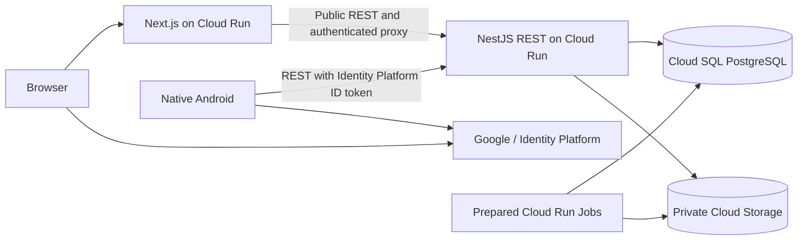

# Blogpost backend implementation plan

Interview decisions accepted on 25 October 2026. This document is the authority for shared domain rules. [API_CONTRACT_V1.md](API_CONTRACT_V1.md) is authoritative for REST wire behavior, DTOs, headers, errors, versions, and compatibility. These are implementation plans; no service or cloud resources have been created.

Related documents: [web plan](BLOGPOST_FRONTEND_WEB_PLAN.md), [Android plan](BLOGPOST_FRONTEND_ANDROID_PLAN.md), [backend deployment](BACKEND_DEPLOYMENT_GUIDE.md), [web deployment](FRONTEND_WEB_DEPLOYMENT_GUIDE.md).

Delivery policy update: [VCS_GUIDELINE.md](VCS_GUIDELINE.md) and [CI_CD_GUIDELINE.md](CI_CD_GUIDELINE.md) govern reviewed `rc` integration, explicit releases, and automatic backend/web deployment after publication. The Console deployment guides remain setup/recovery procedures.

[BUILD_VARIANTS_PLAN.md](BUILD_VARIANTS_PLAN.md) governs local Docker Development from feature/work branches, automatic RC Staging in its own GCP project, and independently rebuilt main Production. Both cloud environments use `NODE_ENV=production` with distinct validated `APP_ENV`/identity/SQL/storage inputs; local emulators/media adapters cannot activate in either cloud environment.

## 1. Agreed product and planning defaults

Build a publication where anonymous visitors read and invited staff write. Authors submit work; editors/admins review and publish from either client. Web additionally provides invitations, roles, and taxonomy administration. Published content remains stable while a separate working revision changes.

| Area       | Decision                                                                                                              |
| ---------- | --------------------------------------------------------------------------------------------------------------------- |
| Backend    | Node.js, TypeScript, NestJS, Prisma, REST under `/v1`                                                                 |
| Database   | Cloud SQL PostgreSQL; accept its idle running cost                                                                    |
| Identity   | Google sign-in through Identity Platform; SQL membership controls application access                                  |
| Web        | Next.js, server-rendered public pages, thin server proxy for authenticated browser requests                           |
| Android    | Existing native Compose/MVI scaffold; full editorial workflow                                                         |
| Content    | Markdown: headings, emphasis, lists, quotes, links, images, fenced code, simple tables; no raw HTML/scripts           |
| Drafts     | Durable local saves; explicit online sync; manual conflict resolution; online publication                             |
| Media      | Private JPEG/PNG/WebP storage; validated/processed by backend; access-aware delivery                                  |
| Taxonomy   | Editors/admins manage it; one category and at most five tags per published revision                                   |
| URLs       | Stable published slugs; editor changes create redirects                                                               |
| Removal    | Immediate denial of new public requests; 30-day application trash; offline copies removed after a successful check    |
| Operations | Per-feature Docker development/test stacks plus isolated Staging/Production projects; daily backups and restore drill |
| Deployment | Reviewed `rc` → `main` marked release, immutable artifacts, automatic GCP deployment; Console setup/recovery          |

Defaults delegated during interview: English UI/content, initially Indonesian readers, Jakarta `asia-southeast2` where supported, working name **Blogpost**, one developer, no fixed deadline, approximately 10 staff and 1,000 posts. The original US$30 target no longer represents the expanded two-project setup: estimate both environments and set separate project budgets before provisioning. Model an initial 100 visits/day and short bursts of 5 requests/second as sizing assumptions. Staging stays available, preserves synthetic content, uses three daily backups and compatible migrations; never copy production data there.

No reader registration, comments, reactions, follows, analytics, ads, legacy import, push/email notifications, scheduled publication, coauthor editing, automatic background draft sync, or collaborative live editor in release 1. Optional draft Markdown export supports recovery; it is not a bulk migration feature.

## 2. Architecture and implementation choices



Use a modular monolith. Modules: `identity`, `members`, `invitations`, `posts`, `editorial`, `taxonomy`, `media`, `search`, `audit`, `health`, and `operations`. Controllers handle transport; services own rules/transactions; repositories own persistence. Next.js and Android never access SQL or the media bucket directly.

Use patched Node.js 24 LTS, NestJS's supported stable release, **Prisma ORM 7** and its matching client/CLI/driver adapter, PostgreSQL 17, and a locked dependency graph. Prisma 7 is an intentional maintained baseline for the documented `schema.prisma`/`migrate deploy` workflow; do not mix Prisma 8 migration instructions into it. Confirm support and security patches at implementation kickoff. [Node releases](https://nodejs.org/en/about/previous-releases), [Prisma version transition](https://github.com/prisma/orm).

Use Nest validation with unknown-field rejection, `@nestjs/swagger` for OpenAPI, structured JSON logs, the Google Admin SDK using application default credentials, and Sharp for image normalization. Use parameterized SQL for PostgreSQL-specific search/locking. No Redis, Kubernetes, or external search engine initially. Nest provides the chosen OpenAPI integration. [Nest OpenAPI](https://docs.nestjs.com/openapi/introduction).

Suggested backend repository:

```text
src/modules/{identity,members,invitations,posts,editorial,taxonomy,media,search,audit}/
src/platform/{config,database,errors,logging,security}/
src/ops/{bootstrap-db,migrate,verify-db,bootstrap-admin,maintenance}.ts
prisma/schema.prisma
prisma/migrations/
contracts/openapi-v1.json
contracts/fixtures/{markdown,errors,editorial}/
test/{integration,contract}/
Dockerfile
cloudbuild.yaml
docs/release-manifest.example.json
```

## 3. Roles and ownership

Each active member has one role: `AUTHOR`, `EDITOR`, or `ADMIN`. Editor includes author abilities; admin includes editor abilities.

| Action                                                     | Anonymous | Author | Editor      | Admin       |
| ---------------------------------------------------------- | --------- | ------ | ----------- | ----------- |
| Read currently published content/search/profiles           | Yes       | Yes    | Yes         | Yes         |
| Create a post; sync own draft; submit/withdraw own review  | No        | Own    | Any         | Any         |
| Read another author's draft/history                        | No        | No     | Yes         | Yes         |
| Edit/reject/review and publish/withdraw publication        | No        | No     | Yes         | Yes         |
| Trash/restore an unpublished own post                      | No        | Own    | Any         | Any         |
| Trash/restore published or withdrawn posts                 | No        | No     | Yes         | Yes         |
| Manage categories/tags; change published slug              | No        | No     | Yes, web UI | Yes, web UI |
| Invite staff, change role, disable access, reassign author | No        | No     | No          | Yes, web UI |

An editor may publish their own work because they hold the editor role; a separate second-person approval is not required. Publication still names an exact reviewed revision. Keep original author attribution when editors make corrections. Only admin may reassign attribution, with an audit event.

Verify identity and read active membership on every protected operation. Do not trust stale role claims in tokens or hidden buttons. Disablement takes effect on the next server request, even with an otherwise valid token. Serialize last-admin changes so two concurrent demotions cannot remove all active admins. Prefer disablement to deleting author identities referenced by articles.

## 4. Data model and invariants

Use UUID identifiers and UTC timestamps; expose ISO-8601 strings. Keep identity email private. Public profiles contain a stable author ID/handle, display name, plain-text bio, and published articles; use initials rather than a separate avatar-upload feature initially.

| Entity              | Essential fields and constraints                                                                                                                                                                                       |
| ------------------- | ---------------------------------------------------------------------------------------------------------------------------------------------------------------------------------------------------------------------- |
| `Member`            | Unique Identity Platform UID; verified email; display name; unique handle; role; active flag; version; timestamps                                                                                                      |
| `Invitation`        | Email, target role, SHA-256 of random 256-bit token, issuer, seven-day expiry, version, accepted/revoked timestamps; single-use atomic acceptance                                                                      |
| `Post`              | Author/creator, creator-scoped unique `clientDraftId`, canonical slug, `publicationState`, `workflowState`, working/published revision pointers, integer `lockVersion`, first publication time, trash/purge timestamps |
| `Revision`          | Immutable title, summary, Markdown, Markdown-contract version, credited author, category/tag IDs, cover presentation, extracted media references, creator, revision number, checksum, timestamp                        |
| `ReviewEvent`       | Submitted/rejected/withdrawn/published revision ID, actor, optional feedback, time                                                                                                                                     |
| `PublishedSearch`   | One row per currently public post, published revision ID, weighted search vector; updated in publication transaction                                                                                                   |
| `Category`, `Tag`   | Unique normalized name/slug; active/archive state; version                                                                                                                                                             |
| `SlugHistory`       | Globally reserved slug, post ID, canonical/history flag; prevent reuse and redirect chains                                                                                                                             |
| `MediaAsset`        | Owning post, uploader, processed object names/generations, size/dimensions/type, lifecycle state                                                                                                                       |
| `RevisionMedia`     | Revision-to-media references; immutable membership after revision creation                                                                                                                                             |
| `AuditEvent`        | Actor, action, entity ID, safe change metadata, trace ID, time; no tokens/full article body                                                                                                                            |
| `IdempotencyRecord` | Member + method + route + key, semantic request hash, result reference/status, 24-hour expiry; no invitation secret/session replay storage                                                                             |
| `SchemaMeta`        | Application-readable compatible schema version; migration role alone updates it                                                                                                                                        |
| `RateLimitBucket`   | Bounded member/action/time-window counters; atomic increment and expiry cleanup                                                                                                                                        |

Drafts may have no reserved slug until first publication. Reserve the canonical slug in that publication transaction; later title edits never change it automatically. Preserve category/tag slugs when renaming display labels. Archival prevents new selection without removing historical references or silently withdrawing existing articles. Disabling an author's staff access does not withdraw their public posts; an editor/admin withdraws those explicitly.

Publication and workflow are separate dimensions:

```text
publicationState: NEVER_PUBLISHED | PUBLISHED | WITHDRAWN
workflowState:    DRAFT | IN_REVIEW | CHANGES_REQUESTED | CLEAN

Save/sync -> immutable working revision
Submit -> freeze that working revision as IN_REVIEW
Reject -> CHANGES_REQUESTED, preserving feedback and public revision
Withdraw review -> DRAFT; subsequent editing creates a new revision
Review and publish -> atomically select the reviewed revision as public; CLEAN
Start next edit -> DRAFT; previous public revision remains live
Unpublish -> WITHDRAWN; retain revisions and slug reservation
Trash -> hide immediately; eligible for permanent purge after 30 days
Restore -> unpublished DRAFT; explicit review/publication is required again
```

Editing a submitted revision requires withdrawing review first. An editor making a correction creates a new revision and explicitly reviews/publishes that revision. Restoring historical content creates a **new** working revision; it never rewinds history or republishes implicitly.

Publish in one short SQL transaction: lock post, recheck membership/role and expected version, confirm review target, validate category/tags/media readiness, set public pointer/state, refresh search row, append review/audit events, increment version. No image processing or external identity requests inside the transaction. Use the same authorization/version check within other mutation transactions to close permission-change races.

Use foreign keys, unique slug/UID constraints, indexed join tables, check constraints, and service validation. Publication requires a nonempty title/body, summary, one active category, and zero to five active tags. Reject category removal while referenced unless reassignment is part of the same operation. Archive used tags rather than breaking historical revisions.

## 5. REST contract

Implement [API_CONTRACT_V1.md](API_CONTRACT_V1.md). Author the OpenAPI 3.1.2 description first, then publish immutable contract release `1.0.0`, examples, shared Markdown/workflow/error fixtures, stateful mock, and a SHA-256 manifest as backend GitHub release assets after its gates pass. Both clients pin the contract/checksum; API major `/v1` is independent of contract semantic version. Controller-generated documentation is not the contract authority.

Every application JSON success/error uses the eight-field envelope: `timestamp`, `responseKey`, `statusCode`, `traceId`, `message`, `data`, `error`, `meta`. Actual HTTP status matches `statusCode`; clients use stable `error.code`, not message text. Images remain binary on success; health/probe and bodyless exceptions are explicit in the contract.

Require `X-Device-ID`, `X-Device-OS`, `X-Device-Version`, `X-App-Version`, and `X-App-Language` on every application request, including anonymous/media calls. Exempt health probes and CORS preflight. Use visitor metadata for Next.js server calls, and return wrapped `400 INVALID_CLIENT_METADATA` when required application metadata is missing/invalid.

### Endpoint inventory summary

The contract contains complete paths, operation IDs, DTOs, authorization, and supplementary creator/media/history reads. This table is an architectural overview.

| Method and path                                             | Behavior                                                                                                    |
| ----------------------------------------------------------- | ----------------------------------------------------------------------------------------------------------- |
| `GET /health/live`, `GET /health/ready`                     | Process liveness; minimal SQL-readiness response, respectively                                              |
| `GET /v1/meta`                                              | API/contract/build/Markdown-contract versions, no secrets                                                   |
| `GET /v1/public/posts`                                      | Published feed; category/tag/author filters; cursor pagination                                              |
| `GET /v1/public/posts/by-slug/{slug}`                       | Published article or redirect descriptor; never a working revision                                          |
| `GET /v1/public/posts/{id}`                                 | Published article by stable ID                                                                              |
| `GET /v1/public/search?q=...`                               | Ranked published-only search plus filters                                                                   |
| `GET /v1/public/categories`, `/tags`, `/authors/{handle}`   | Public taxonomy and published-author profile                                                                |
| `POST /v1/public/posts/availability`                        | At most 50 IDs; available flag and current public revision ID; unavailable covers unknown/withdrawn/trashed |
| `GET /v1/public/posts/{id}/media/{mediaId}/{variant}`       | Stream a variant only if referenced by that post's current public revision                                  |
| `POST /v1/auth/web-session`                                 | Exchange a recently authenticated Identity Platform ID token for a web session; active membership required  |
| `GET /v1/me`, `PATCH /v1/me`                                | Membership/profile; only permitted profile fields writable                                                  |
| `POST /v1/invitations/accept`                               | Authenticated verified identity accepts matching token; active membership not required beforehand           |
| `GET /v1/posts`                                             | Authorized staff workspace; own posts for authors; broader filters for editors                              |
| `POST /v1/posts`                                            | Create from `{clientDraftId,draft}`; idempotency key required                                               |
| `GET /v1/posts/by-client-draft-id/{clientDraftId}`          | Creator recovery lookup, subject to current access                                                          |
| `GET /v1/posts/{id}`                                        | Staff detail, `data.version`, and `X-Resource-Version`                                                      |
| `PUT /v1/posts/{id}/draft`                                  | Save snapshot with `X-Expected-Version`; unchanged content is a no-op                                       |
| `POST /v1/posts/{id}/submit`, `/withdraw-review`, `/reject` | Explicit review transitions; rejection requires feedback                                                    |
| `POST /v1/posts/{id}/publish`, `/unpublish`                 | Editor/admin actions; publish body names reviewed `revisionId`                                              |
| `GET /v1/posts/{id}/revisions`                              | Authorized history; bounded pagination                                                                      |
| `GET /v1/posts/{id}/revisions/{revisionId}`                 | Exact authorized immutable snapshot for review/comparison/restoration                                       |
| `GET /v1/posts/{id}/review-events`                          | Authorized paginated review feedback/history                                                                |
| `POST /v1/posts/{id}/restore-revision`                      | Copy selected history to a new draft                                                                        |
| `DELETE /v1/posts/{id}`, `POST /v1/posts/{id}/restore`      | Trash and restore with ownership/role checks                                                                |
| `POST /v1/posts/{id}/media`                                 | Independent staged upload; idempotency required, no expected post version or post-version increment         |
| `GET /v1/posts/{id}/media/{mediaId}`                        | Authorized staged/historical asset metadata                                                                 |
| `GET /v1/posts/{id}/media/{mediaId}/{variant}`              | Authorized draft/history media preview                                                                      |
| `PATCH /v1/posts/{id}/slug`                                 | Editor reserves new slug and creates history mapping atomically                                             |
| `/v1/categories`, `/v1/tags`                                | Editor/admin create/update/archive operations with versions                                                 |
| `/v1/admin/invitations`, `/v1/admin/members`                | Admin invitation list/create/revoke; role/active/attribution changes; paginated audit visibility            |

Existing-resource mutations require `X-Expected-Version` and return the committed version in data/`X-Resource-Version`. Require `Idempotency-Key` for application mutations, including draft sync; exempt read-only availability POST and web-session exchange. Staging creates an independent asset, so it does not require an expected post version. Scope operation records by UID + method + route + key. Replay matching completed results before current-version checks, after current authorization. Preserve original outcome/status/version with current timestamp/trace and an explicit replay flag; clients fetch current state before adopting it.

Example draft sync:

```http
PUT /v1/posts/9e62c04a-997e-4edf-a7c4-d5a05a94c758/draft
X-Expected-Version: 7
Idempotency-Key: 83c9a1ca-6d20-48c5-8476-bb6a60677377
X-Device-ID: 8d5ca46a-7f59-4f64-9d91-fedc41b59e7a
X-Device-OS: ANDROID
X-Device-Version: 16
X-App-Version: 1.0.0+android.1
X-App-Language: en
Authorization: Bearer <IdentityPlatformIdToken>
Content-Type: application/json

{"title":"A first article","summary":"A useful summary.","markdown":"# Hello\n\nBody text.","categoryId":"30000000-0000-4000-8000-000000000001","tagIds":[],"coverMediaId":null}
```

Success returns the full wrapped `WorkspacePost` with version 8 in data/`X-Resource-Version` unless unchanged. Conflicts preserve server and client work. Missing precondition is 428; stale version 412; workflow/slug/idempotency conflict 409.

Wrapped conflict example:

```json
{
  "timestamp": "2026-10-25T08:21:00.000Z",
  "responseKey": "ERROR",
  "statusCode": 412,
  "traceId": "4bf92f3577b34da6a3ce929d0e0e4736",
  "message": {
    "title": "Draft changed",
    "descriptions": "Fetch the current revision before resolving this conflict."
  },
  "data": null,
  "error": {
    "code": "VERSION_CONFLICT",
    "fieldErrors": [],
    "context": {
      "currentVersion": 8,
      "currentRevisionId": "20000000-0000-4000-8000-000000000008",
      "resourceType": "POST",
      "resourceId": "9e62c04a-997e-4edf-a7c4-d5a05a94c758",
      "expectedVersion": 7,
      "resourcePath": "/v1/posts/9e62c04a-997e-4edf-a7c4-d5a05a94c758"
    }
  },
  "meta": {
    "contractVersion": "1.0.0",
    "pagination": null,
    "idempotency": null
  }
}
```

Also define `401` invalid/expired identity, `403` valid identity without permission, `404` unavailable/inaccessible resource, `413` oversized upload, `422` field validation, `429` throttling with `Retry-After`, and `503` temporary dependencies. Field errors use stable machine codes and field paths, not UI-ready text. Never expose SQL errors or whether another author's inaccessible draft exists.

Feed defaults to 20, maximum 50; cursors bind filters/order/page size and expire after 24 hours. Search uses pages of 20, maximum 50, exposing the first 1,000 ranked matches with explicit truncation metadata. Keep arrays in `data` and pagination in `meta.pagination`. Category/author filters select one ID; selected tags use AND semantics. Concurrent publication is not a frozen snapshot; clients deduplicate by ID.

## 6. Identity, sessions, and invitation security

1. Google sign-in yields an **Identity Platform** ID token. A raw Google OAuth ID token is not an API credential.
2. Android sends `Authorization: Bearer <IdentityPlatformIdToken>`. Validate signature, issuer, audience/project, expiry, revocation, verified email, Google provider, and SQL membership.
3. For web, Next.js accepts a recent sign-in token through a same-origin CSRF-protected login route. It calls `/v1/auth/web-session`; backend checks `auth_time` within five minutes and returns a five-day Identity Platform session cookie to the server proxy only.
4. Next.js sets `__Host-blogpost_session` with `HttpOnly`, `Secure`, `SameSite=Lax`, `Path=/`, no Domain. Browser never receives that session value as JSON. After exchange, clear the client SDK's in-memory sign-in state; do not persist browser refresh tokens.
5. The proxy forwards the session as `X-Blogpost-Web-Session`. Backend calls `verifySessionCookie(..., true)`, then applies identical membership rules. Reject ambiguous requests containing both credential types. The header is a verified credential, never a trusted user/role assertion.
6. Protect browser mutations, login, and logout with exact `Origin` checks, JSON/content-type checks, and a CSRF token tied to a secure same-origin token cookie. Allowlist proxy paths/methods and the configured backend origin; do not provide an arbitrary URL proxy.

Session cookies require independent server-side permission checks. [Managed session cookies](https://firebase.google.com/docs/auth/admin/manage-cookies).

Invitation acceptance requires the exact invited verified Google email, unexpired/unrevoked token, and a single transaction that consumes it and binds the UID. Normalize casing/whitespace only; do not collapse email aliases. Store only token hashes. Make landing pages `no-store`, `noindex`, and `Referrer-Policy: no-referrer`; remove the token from the displayed URL after capture and never log it. Reissuing revokes the prior invitation. No email provider is needed: admin copies the link and shares it manually.

Invitation create/reissue replay returns its original receipt with `inviteUrl:null` and `linkAvailable:false`, never a stored secret link. Admin explicitly reissues a replacement after a lost secret response. Other completed operations replay their original domain result for 24 hours, with current response timestamp/trace.

Bootstrap the first admin with a prepared, private job after their first Google sign-in creates an Identity Platform identity. Operator supplies that UID and verified email; job independently checks the identity, permits creation only when no active admin exists, and is safely idempotent for that same member. There is no public bootstrap endpoint or permanent bootstrap environment variable on the API.

## 7. Markdown, media, search, and removal

Define Markdown contract version `1`. Parse to an AST on the server for validation/media extraction. Bound Markdown to 128 KiB UTF-8, title 160 characters, summary 320, and bio 500. Support plain fenced code with optional language labels; syntax coloring is presentation. Reject unsupported constructs on publication and show actionable editor feedback. Render HTML-like source as text; prohibit dangerous URL schemes.

Images use `` in canonical Markdown. Renderers translate that reference into the appropriate API route. Reject arbitrary external image URLs; external HTTPS article links are permitted. Validate asset ownership/reference server-side; require meaningful alt text or an explicit decorative marker. Simple tables have a header row and no merged cells. Keep equivalent rendering fixtures in all three repositories.

Upload rules: maximum 5 MiB encoded file, 12 megapixels decoded, one image/frame, MIME plus magic-byte validation, decode timeout, and one transform at a time per API instance. Normalize orientation, remove metadata, generate immutable 480/960/1600-pixel variants without upscaling, preserve needed transparency. Reject SVG, animation, video, malformed files, and decompression bombs. Discard originals after successful normalization. Store object generations and clean up partial failures idempotently.

Cloud Storage objects remain private, including published assets. Public media routes recheck the post's current published revision on every request; draft routes check staff access. Do not redirect to storage or issue public/signed delivery URLs. Return `Cache-Control: no-store`, correct image MIME, `nosniff`; no shared CDN or Next image-optimization cache. A media asset may be reused within its owning post, never across unrelated posts. Unattached uploads expire after 24 hours; clients retain local source until a revision referencing the upload is committed.

Search indexes **only published snapshots**, never draft text. Use English weighted title/summary/plain body vectors, GIN index, `websearch_to_tsquery`, and ranking. Bound query to 200 characters; reject non-indexable queries clearly. Search filters use public author/category/tag IDs. Escape snippets as plain text, even if highlighting is later added. [PostgreSQL text search](https://www.postgresql.org/docs/17/textsearch-controls.html).

Withdrawal/trash removes search and public access in the publication transaction. In-flight responses, already open pages, downloaded/exported material, and offline copies cannot be recalled. Android purges cached article/media after a successful unavailable response; network failure is not proof of withdrawal. Bookmarks remain as unavailable records.

Trash recovery lasts 30 days; restore never auto-publishes. A daily maintenance job purges eligible posts and unreferenced assets, abandoned uploads, expired invitation/idempotency records, and audit metadata beyond 90 days. Keep media referenced by any retained revision. Use a SQL advisory lock and retry-safe tombstones for SQL/object-storage cleanup; mark completion only after deletion succeeds. Backups and storage soft deletion can retain removed bytes longer; the UI's 30-day trash promise is not a physical-erasure guarantee.

Bound local and remote draft growth: cap a single staff member at 100 active posts/100 MiB of pending uploads initially, return a clear quota error with cleanup options, and expose these limits as configuration. Keep historical revisions for live posts in this release, with a measured storage alert rather than silently truncating revision history. Prune expired rate-limit buckets during maintenance.

## 8. Deployment artifacts and operating limits

The developer must supply these before the Console guide can work:

| Artifact                      | Required behavior                                                                                                                                                                                                         |
| ----------------------------- | ------------------------------------------------------------------------------------------------------------------------------------------------------------------------------------------------------------------------- |
| `Dockerfile`                  | Development reload stage plus common optimized cloud build/runtime stages; separate Staging/Production provenance; Linux amd64, patched Node 24, non-root, `0.0.0.0:$PORT`, migrations/Prisma/ops scripts; no credentials |
| `cloudbuild.yaml`             | Locked install, checks, disposable local PostgreSQL integration tests, contract compatibility check, image build/push; **no deploy or production migrations**                                                             |
| `dist/ops/bootstrap-db.js`    | Temporary root connection; create least-privilege app/migrator roles and schema; safe rerun; no secret output                                                                                                             |
| `dist/ops/migrate.js`         | Construct encoded migration URL in memory from secret/config fields; run bundled Prisma 7 `migrate deploy`; no schema reset/push/dev migration                                                                            |
| `dist/ops/verify-db.js`       | Check schema version, required grants/search indexes, and that runtime role cannot perform DDL                                                                                                                            |
| `dist/ops/bootstrap-admin.js` | Verified UID/email, initial admin guard described above                                                                                                                                                                   |
| `dist/ops/maintenance.js`     | Bounded idempotent retention work with job lock                                                                                                                                                                           |

Bootstrap the dedicated `blogpost` schema with owner `blogpost_migrator`; `blogpost_app` receives only required table/sequence access. Neither is a superuser or member of `cloudsqlsuperuser`. Migration wrapper grants runtime access to application tables after migration, excluding migration history; `SchemaMeta` is read-only to runtime. Immutable revision content has no runtime UPDATE grant. The API still needs controlled access to application membership/audit tables to enforce administrative operations. Root credentials are not mounted on any long-lived service.

Use the Cloud Run built-in Cloud SQL connection and `/cloudsql/INSTANCE_CONNECTION_NAME` Unix socket, with public IP enabled but no authorized public networks. IAM Cloud SQL Client permits connection; SQL username/password still determines database privileges. Keep all services and bucket in Jakarta unless the Console identifies a capability gap. [Cloud Run to Cloud SQL](https://docs.cloud.google.com/sql/docs/postgres/connect-run).

Initial API limits: 1 vCPU, 1 GiB memory, request-based billing, minimum 0, service maximum 2 instances, concurrency 20, 60-second request timeout. One global Prisma/pg pool per instance, maximum 3 connections, bounded acquire timeout; operations job pool maximum 2. Reserve connections for administration and temporary overlapping revisions. Service caps are cost/capacity controls, not hard bill or connection guarantees.

Use process-local anonymous throttling plus SQL-backed fixed-window per-member write/upload limits; initially 30 writes/minute and 10 uploads/minute. Login/invite endpoints have stricter limits. Document that anonymous per-instance throttling is approximate across replicas. Never trust arbitrary forwarded IP headers; configure trusted proxy handling explicitly. Avoid a paid load balancer solely for this portfolio release; revisit edge rate limiting if public abuse warrants it.

Logs contain trace IDs, route template/status/latency, actor ID for protected actions, and dependency errors without payloads. Hash retained device identifiers. Redact auth/session headers, cookies, invitation URLs, SQL connection strings, Markdown, and image bytes. Monitor 5xx, readiness, memory, DB connections/disk, failed maintenance/backups, and spend. Warm-path targets: public API p95 under 500 ms at the stated test load; cold starts are allowed and reported separately. Recovery targets: up to 24 hours lost data, several hours downtime; daily backups do not guarantee that objective if a backup fails.

## 9. Implementation sequence and acceptance gates

1. **Foundation and contract:** repository, locked toolchain, Nest modules, validation/errors, schema, OpenAPI 1.0.0, fixtures, health/meta. Gate: migration works from empty local PostgreSQL and contract examples validate.
2. **Identity and authorization:** both credential schemes, membership, initial-admin operation, invitation lifecycle, profile, role changes, audit. Gate: author/editor/admin permission matrix and last-admin races pass integration tests.
3. **Editorial core:** immutable snapshots, version preconditions, review/publication transaction, URL history, trash/restore. Gate: an old client cannot overwrite newer work; publishing a stale/unreviewed revision fails; public content never includes draft fields.
4. **Media/search:** normalization/private streaming, published search, taxonomy filters, availability checks, retention job. Gate: withdrawn media becomes unavailable; same asset ID cannot be read through another post; drafts never match public search.
5. **Client integration:** deliver pinned contract assets, validate web session/CSRF and Android token flows, shared Markdown fixtures, uncertain-request retry scenarios. Gate: one post can be authored, reviewed, published, revised, and withdrawn across the two clients without data loss.
6. **Release readiness:** prepared build/jobs, secret handling, permission verification, backup/restore drill, release manifest, and CI/CD rehearsal. Gate: a reviewed marked main promotion publishes once, deploys the fixed digest, and can restore previous traffic; Console setup/recovery remains available.

Required meaningful tests: real-PostgreSQL integration tests for publication/search/constraints/races; unit tests for pure rules/Markdown reference validation; security tests for cross-user reads, token/session mixups and CSRF; image limits and malformed inputs; idempotent retries after response loss; migration from previous supported schema; OpenAPI breaking-change detection; contract examples consumed by web and Android. Do not substitute mocked Prisma calls for database invariants.

Use the push/PR checks and trusted-main release/deployment chain in [CI_CD_GUIDELINE.md](CI_CD_GUIDELINE.md), with read-only CI defaults and secret-free fork runs. Cloud Build is a manual bootstrap/recovery alternative. Follow the contract's compatibility policy: fixed v1 role/workflow enums, additive optional responses, no new required headers, and explicit `/v2` for breaking changes. Retirement is no earlier than 12 calendar months after the successor is ready on both clients, 90 days after notice, or any longer existing commitment. Test old-client behavior; never add a required field silently.

Backend owns shared Compose orchestration with per-workspace project names/volumes/ports, local auth emulator and media adapter, optional web checkout, and explicit safe cleanup. RC has a separate staging-only pipeline; Production promotion requires its current staging receipt and owner validation. Build/meta provenance and docs-only input-equivalence follow the variant plan.

Indicative original effort: backend 4–6 weeks, web 3–4, Android 5–7, shared release/recovery work 1–2; roughly 13–19 weeks sequentially, before expanded variant/staging work. Re-estimate after proving Docker isolation, six Android configurations, and promotion evidence. These are allowances, not commitments. Revisit dedicated capacity, private networking, shared caching/CDN, stronger throttling, and tighter recovery after measurements justify their cost.
