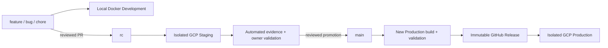

# Blogpost build variants and environment plan

Interview decisions accepted on 25 October 2026. This is the authority for environment selection, local Docker development, Android flavors, staging evidence, and promotion. It extends [the backend plan](BLOGPOST_BACKEND_PLAN.md), [web plan](BLOGPOST_FRONTEND_WEB_PLAN.md), [Android plan](BLOGPOST_FRONTEND_ANDROID_PLAN.md), [VCS guideline](VCS_GUIDELINE.md), and [CI/CD guideline](CI_CD_GUIDELINE.md). [API_CONTRACT_V1.md](API_CONTRACT_V1.md) remains the wire-contract authority.

**Status:** planning deliverable. No application code, Docker configuration, workflow, signing material, or cloud resources have been created by this documentation change. Commands/file layouts below specify subsequent implementation work.

## 1. Decisions and changed assumptions

| Area               | Agreed decision                                                                                                           |
| ------------------ | ------------------------------------------------------------------------------------------------------------------------- |
| Development source | `feature/*`; executable `bug/*` and `chore/*` use the same Development profile                                            |
| Staging source     | Exact reviewed `rc` commit                                                                                                |
| Production source  | Exact reviewed `main` promotion merge commit                                                                              |
| Local runtime      | Docker Compose backend, web, PostgreSQL, authentication emulator, and local media storage; Android tools on the host      |
| Local isolation    | Separate Compose project, volumes, identity namespace, and host ports per active feature workspace                        |
| Cloud isolation    | Separate staging and production GCP projects, databases, buckets, identity projects, accounts, secrets, and registries    |
| Staging update     | Automatic after successful RC code checks; preserve synthetic data                                                        |
| Artifact promotion | Build staging from `rc` and production from `main` separately, using the same reviewed Dockerfiles/toolchain              |
| Android matrix     | Three environment flavors × debug/release: all six enabled                                                                |
| Android identities | Environment suffixes plus `.debug` for debug types; six application IDs                                                   |
| Distribution       | RC: signed `stagingRelease` APK as expiring Actions artifact; main: signed `productionRelease` APK/AAB on GitHub Releases |
| Production debug   | Local anonymous reading diagnostics only; no staff sign-in, CI distribution, or production signing key                    |
| Staging access     | Public anonymous reading of synthetic content; real invited-staff authentication for authoring                            |
| Promotion          | Successful evidence for the current RC candidate plus recorded owner validation; docs-only equivalence is explicit        |
| Staging operations | Always available, Cloud Run minimum zero, smallest suitable single-zone SQL, three daily backups, compatible migrations   |

The earlier single-cloud-environment assumption is superseded. The earlier main-only **production** credential boundary remains; new RC-only credentials can affect staging only. A Gradle build type named `release` does not mean the Production environment: `developmentRelease` remains local/emulated, and `stagingRelease` remains staging.

Tags/GitHub Releases remain main-only. Ordinary PR/fork runs have no signing/cloud credentials. Only `push` and `pull_request` workflow events are permitted. No real `.env` or signing key is committed; only a sanitized `.env.example` is allowed under the existing policy.

## 2. Branch, build, and environment matrix

| Source/event                | Backend                                      | Web                                 | Android                                                | Side effects                                                  |
| --------------------------- | -------------------------------------------- | ----------------------------------- | ------------------------------------------------------ | ------------------------------------------------------------- |
| Feature/bug/chore workspace | Development Docker target, reload            | Development Docker target, Next dev | Development variants; normally `developmentDebug`      | Local stack only                                              |
| Work push / PR              | Disposable test services, contract checks    | Tests and environment build checks  | Unsigned compilation/tests; no distributed APK         | Reports only                                                  |
| Reviewed RC code push       | Optimized Staging image                      | Optimized Staging image             | Build/test staging variants, sign `stagingRelease`     | Staging deploy / Actions artifact                             |
| Docs-only RC push           | Reuse only proven-equivalent staged artifact | Same                                | Reuse only equivalent staged APK                       | Current-candidate verification receipt; no app rebuild/deploy |
| Marked main promotion       | Optimized Production image                   | Optimized Production image          | Validate production variants, sign `productionRelease` | Tag/release; backend/web production deploy                    |
| Docs-only main promotion    | Policy/docs checks                           | Policy/docs checks                  | Policy/docs checks                                     | No tag, release, signing, or deployment                       |

Definitions of all six Android variants stay available in Gradle, independently of the checked-out branch. Compilation-only checks may exercise other configurations with nonsecret test inputs. Runnable environment builds, cloud deployment, signing, and publication must satisfy the source mapping above. No feature/PR artifact is promoted into staging or production without rebuilding from its authorized ref.

Local `stagingDebug` diagnostics use a clean RC snapshot; local `productionDebug` diagnostics use a clean main snapshot. Development permits a dirty tree and records that state. Detached CI checkouts use the trusted event ref/SHA; never guess a branch from detached HEAD or trust a contributor-supplied environment argument. Local guards prevent mistakes; backend authentication/authorization never relies on a claimed branch or app variant.

The repositories remain independent. Matching branch names are not required. Pin the API contract/checksum, use the local API or stateful mock, and record counterpart versions during related integration checks. No fourth orchestration repository or forced three-repository release is introduced.



## 3. Configuration model and fail-fast rules

Use `APP_ENV=development|staging|production` as the application environment. Keep framework `NODE_ENV=development` for reload servers, `test` for isolated tests, and **`production` for both optimized Staging and Production**. Never set `NODE_ENV=staging`. Next.js supports the standard development/production/test values. [Next.js environment rules](https://nextjs.org/docs/app/guides/environment-variables)

Bake nonsecret build provenance into artifacts: environment, source SHA, application version, contract checksum, and normalized build-input digest. Validate runtime `APP_ENV` against the built environment. Staging/Production share one implementation and optimized Docker recipe, with different configuration and separately produced digests. A deployed image cannot be repointed to another environment by changing one URL.

| Configuration          | Development                               | Staging                                    | Production                                    |
| ---------------------- | ----------------------------------------- | ------------------------------------------ | --------------------------------------------- |
| Identity               | Per-stack `demo-...` emulator project     | Staging Identity Platform/Firebase project | Production Identity Platform/Firebase project |
| Database               | Stack's PostgreSQL volume                 | Staging project's Cloud SQL                | Production project's Cloud SQL                |
| Media                  | Stack-private filesystem adapter          | Staging private bucket                     | Production private bucket                     |
| Transport              | Host-loopback HTTP                        | HTTPS                                      | HTTPS                                         |
| Emulator/mock controls | Explicit local adapters only              | Forbidden                                  | Forbidden, including `productionDebug`        |
| Browser session        | Stack-specific local cookie configuration | Host-only Secure/HttpOnly cookie           | Separate host-only Secure/HttpOnly cookie     |
| Dataset                | Synthetic local seed                      | Persistent synthetic articles/drafts       | Live publication data                         |

Validate paired configuration at startup: API origin, identity project, expected audience/issuer, web origin, SQL target, storage adapter/bucket, and environment. Staging/Production reject emulator host variables, local storage adapters, cleartext endpoints, mock routes, fixture credentials, and debug identity controls. Wrong-project credentials fail verification even if the same Google email is invited in both environments. Read current SQL membership independently in each environment.

Do not ship cloud credentials in browser or Android configuration. Public client IDs/API keys are not server credentials; restrict them appropriately. Runtime passwords/CSRF secrets remain environment-local Secret Manager references. Use numeric secret versions, not mutable `latest` aliases. Do not clone production users, membership, SQL backups, or media into staging.

Each client has a fixed destination. There is no runtime environment switcher. Development local endpoint/identity inputs can be selected **at build/start time** from its stack configuration; they cannot select cloud staging/production. Tests can substitute transports through test-only DI without creating a distributed endpoint override.

Keep the same eight-field envelope, API major, mandatory five metadata headers, and version/idempotency behavior in every environment. `X-App-Version` describes the calling app, not the backend's app version. Do not add a required environment header or use diagnostic headers as authorization.

Add the optional `ApiMeta.deployment` fields specified in the API contract update: environment, revision, runtime-input digest, and configuration digest. Keep existing `buildSha` as the SHA that **actually built the serving artifact**. Web exposes equivalent safe data on its infrastructure `/health/build` route. No secrets, tokens, connection strings, or raw configuration appear there. Operational gates can require this metadata; old business clients ignore the optional fields. A response's self-description supplements trusted deployment receipts and TLS/origin checks; it is not a security credential.

## 4. Local Docker development

### 4.1 Ownership and service topology

The backend repository owns the shared Compose recipes and helper scripts. Web/Android READMEs link to them. The developer checks out sibling backend/web/Android repositories independently; a local `WEB_SOURCE_DIR` points at the chosen web checkout. Keep absolute workstation paths out of committed files.

Planned backend files:

```text
Dockerfile                    development, build, runtime stages
compose.yaml                  PostgreSQL, auth emulator, API; optional web service
compose.mock.yaml             standalone pinned stateful API mock plus optional web
docker/auth/                  pinned emulator image and nonsecret demo configuration
scripts/dev/                  stack create/start/status/stop/seed/cleanup helpers
config/*.example.json         sanitized nonsecret configuration examples
.local/stacks/<stackId>/      ignored generated env, context, and port registry
```

Real-stack services: PostgreSQL 17; pinned Authentication Emulator; reloadable Nest API; optional reloadable Next web; named media and dependency/cache volumes. Android Studio, JDK/Gradle, emulator, and `adb` run on Windows host. Use Docker's Linux-container mode. The CI toolchain stays locked to the app plans; do not bundle a scaffold/toolchain upgrade into variant work.

Each developer stack has a stable sanitized project name, for example `blogpost-dev-conflicts-a1b2c3`. Include workspace identity/hash, not just the branch slug, to avoid collisions. Name PostgreSQL/media/auth volumes and networks through that Compose project. Do not use globally fixed `container_name`, volume names, or shared database paths. Compose project names provide resource separation; host ports still need separate allocation. [Compose project names](https://docs.docker.com/compose/how-tos/project-name/)

Only optional services, such as web or a diagnostics UI, need Compose profiles. Start the normal core stack without a profile. A separate mock recipe supports frontend-only development without pretending that a scenario server proves PostgreSQL correctness. Pin its contract release and use development-only identity adapters. [Compose profiles](https://docs.docker.com/compose/how-tos/profiles/)

### 4.2 Files, reload, and networking

Bind source or use reviewed Compose Watch rules; keep container `node_modules` and compilation caches in named volumes. Rebuild when lockfiles, native image dependencies, Dockerfiles, or tool versions change. Do not mount the host Docker socket, production credentials, the user's full home directory, or a cloud service-account key. Prefer Linux/WSL-backed source storage when Windows filesystem performance warrants it; document the actual checkout location and editor integration. [Compose Watch](https://docs.docker.com/compose/how-tos/file-watch/)

Example first-stack addressing; helpers allocate unused ports for later stacks:

| Caller             | API                                                                                         | Auth emulator                         | Web                           |
| ------------------ | ------------------------------------------------------------------------------------------- | ------------------------------------- | ----------------------------- |
| Compose containers | `http://api:8080`                                                                           | `http://auth:9099`                    | `http://web:3000` when needed |
| Host browser       | Through web/BFF at `http://localhost:3000`; direct API debugging at `http://localhost:8080` | `http://localhost:9099` for local SDK | `http://localhost:3000`       |
| Android emulator   | `http://10.0.2.2:8080/`                                                                     | `10.0.2.2:9099`                       | Host browser handles web      |
| USB Android        | `http://127.0.0.1:8080/` after reverse forwarding                                           | `127.0.0.1:9099` after forwarding     | Host browser handles web      |

Publish host ports on `127.0.0.1`, not all interfaces. API/web listen on `0.0.0.0` **inside** their containers. Keep SQL internal by default; an optional loopback SQL port is for deliberate developer tools only. Browser/mobile configuration must not contain Docker-only names such as `api` or `auth`. Next server and browser identity adapters need their respective internal/external emulator addresses.

The Android emulator's `10.0.2.2` reaches the host loopback. For a USB device, forward both selected API and emulator ports with `adb reverse`; do not open the stack to the LAN just to connect a phone. [Emulator address space](https://developer.android.com/studio/run/emulator-networking-address), [local reverse forwarding](https://developer.android.com/develop/ui/views/layout/webapps/access-local-server)

Illustrative first-stack commands after implementation, from the backend checkout:

```powershell
docker compose --project-name blogpost-dev-conflicts-a1b2c3 --env-file .local/stacks/conflicts-a1b2c3/.env --profile web up --build
adb -s DEVICE_SERIAL reverse tcp:8080 tcp:8080
adb -s DEVICE_SERIAL reverse tcp:9099 tcp:9099
```

These commands assume the future files/generated configuration exist. Physical-device builds select the paired localhost endpoint/project at build time; emulator builds select the bridge. For other stacks substitute their assigned ports and regenerate matching Development client inputs. Never use a production database URL as a local fallback.

### 4.3 Data, sessions, and safe lifecycle

Stack creation generates ignored local configuration and synthetic SQL passwords. The helper records stack ID, checkout paths/SHAs, ports, demo identity project, contract pin, and volume labels; it prints endpoints rather than credentials. Seed only that stack with deterministic synthetic authors/editors/admins and media. Fixture identities still receive roles from local SQL, not from a trusted role header.

The Authentication Emulator issues unsigned tokens, accepted only by the explicitly configured local Admin SDK. Staging and Production must reject this mode at startup. Development test sign-in is clearly labelled as emulated; it does not prove real Google sign-in. [Authentication Emulator behavior](https://firebase.google.com/docs/emulator-suite/connect_auth)

The local media adapter implements the same owning-post checks, immutable media IDs/generations, image validation, streaming, and withdrawal rules as the cloud adapter. Run shared adapter tests; verify real Cloud Storage IAM, generation preconditions, and deletion behavior in staging. Do not equate a filesystem adapter with a cloud storage emulator.

Use separate local cookie names incorporating the stack ID, distinct CSRF bindings, and stack/project namespaces for browser sessions. Cookies are not isolated by port; different localhost web ports alone do not isolate sessions. IndexedDB/local recovery keys also include stack identity and authenticated member. [Cookie port isolation](https://www.rfc-editor.org/rfc/rfc6265.html#section-8.5)

Android environment/build-type IDs isolate six installations. Within a Development installation, namespace local work by stack identity, API origin, and member. On rebuilding against another local stack, preserve old unsynced work in a recovery/export namespace; never silently upload it to the new database. This is not a runtime endpoint switcher. Keep device identifiers diagnostic and persist them within their browser/app scope across sign-ins.

`stop`/ordinary `down` preserves named data. Cleanup lists exact stack/project/volume labels and requires an explicit local operation; never use global Docker pruning or unconditional `down -v` in normal startup. Branch switches do not run down migrations against another branch's volume. An incompatible local schema is resolved by restoring/resetting that explicitly selected synthetic stack, after recovering drafts.

## 5. Backend variants

Use one Nest implementation, schema, REST contract, and permission matrix. Docker's Development stage installs the required development tools and runs the reload server. Both cloud environments use the same build/runtime stages, nonroot Linux image, Node version, Prisma generation, and image normalization pipeline, with separate build provenance and runtime configuration.

`APP_ENV` selects explicit identity/storage/configuration adapters. It never grants an admin role or bypasses validation. Development-only seeds/reset helpers are private local tools; there is no cloud reset/fixture-auth HTTP endpoint. Staging/Production migrations run only in the prepared jobs under their own migrator identity; API startup never performs DDL.

Before serving traffic, reject missing/mismatched environment, project, bucket, SQL attachment, and identity audience. `NODE_ENV=production` plus emulator variables is invalid. In Cloud Run reject the Development profile entirely. Keep short-lived cloud ADC on runtime service accounts; local Docker needs no cloud credentials for the chosen emulator/filesystem setup.

Run the same contract and real-PostgreSQL invariants against both optimized configurations. Stage deployment uses its own backup → compatible migration → schema/grant verification → no-traffic candidate → smoke → traffic/observation sequence. Production repeats validation on its new main-built image rather than claiming byte equality with staging.

## 6. Next.js variants

Development uses Next dev in Docker. Staging and Production use optimized standalone builds with `NODE_ENV=production`, distinct public Identity Platform configuration, canonical origin, and baked environment/provenance. Backend URLs and session/CSRF credentials remain server-only. Keep all visitor metadata forwarding, dynamic no-store public reads, BFF auth, and access-aware media delivery.

`NEXT_PUBLIC_*` values are compiled into the browser bundle; supply the correct environment before `next build`. Runtime deployment variables cannot retarget those bundled values. This plan deliberately rebuilds the Production image from main instead of promoting Staging's bytes. Do not introduce `.env.staging` loading through a nonstandard `NODE_ENV`; use validated build/runtime input injection. [Next.js build-time values](https://nextjs.org/docs/app/guides/environment-variables)

Always show a persistent accessible Development/Staging banner, environment in page title/staff confirmations, and the correct canonical/share/invitation host. Staging emits `X-Robots-Tag: noindex, nofollow, noarchive` on public responses and matching robots metadata; omit it from production. These controls discourage indexing, not access. Staging content is public and synthetic only; staff identity/email/session data remains private.

Use independent host-only cookies, CSRF secrets, OAuth authorized domains, and session issuers per cloud project. Do not set a parent-domain cookie shared between environments. Local HTTP's non-Secure development cookie exception is strictly local; CI HTTPS tests and staging verify the actual Secure/HttpOnly/SameSite behavior. Staging origin is never added as a production login/CSRF origin.

The Web `/health/build` response reports only environment, source SHA, runtime-input digest, configuration digest, and serving revision. It is no-store and distinct from process/SQL liveness. Source/runtime values must agree; display a safe configuration error rather than connecting a Staging web bundle to Production backend/identity.

## 7. Android flavors, types, and signing

### 7.1 All six variants

Add one `environment` flavor dimension to `:app`: `development`, `staging`, `production`. Retain `debug` and `release` build types, without disabling any combination. Android forms variant names by combining flavor and build type. [Android build variants](https://developer.android.com/build/build-variants)

Let `BASE_ID` be the final owned application ID, still a setup input:

| Variant              | Application ID          | Destination / staff capability                          | Signing / distribution                                           |
| -------------------- | ----------------------- | ------------------------------------------------------- | ---------------------------------------------------------------- |
| `developmentDebug`   | `BASE_ID.dev.debug`     | Local emulator/API; full synthetic workflow             | Host debug key; local use                                        |
| `developmentRelease` | `BASE_ID.dev`           | Same local destination; full synthetic workflow         | Local nonproduction test key when installing; no CI distribution |
| `stagingDebug`       | `BASE_ID.staging.debug` | Staging API/identity; invited staging workflow          | Host debug key registered in staging; local diagnostics          |
| `stagingRelease`     | `BASE_ID.staging`       | Staging API/identity; invited staging workflow          | Stable dedicated staging key; RC Actions APK artifact            |
| `productionDebug`    | `BASE_ID.debug`         | Production anonymous reads only; no staff sign-in/tools | Host debug key; clean-main local diagnostics only                |
| `productionRelease`  | `BASE_ID`               | Production API/identity; normal invited staff workflow  | Preserved production signing identity; main GitHub APK/AAB       |

Apply `.dev`/`.staging` at flavor level and `.debug` at debug-type level. Use distinct launcher badges/names; Production Debug clearly says **Production read-only debug**. Production staff action confirmations identify Production; nonproduction indicators remain persistent. Do not use the placeholder `com.example.blogpost` as a published identity.

All six compile and relevant unit/configuration tests run without CI signing secrets. Sign only the intended artifact in a separate credential-bearing job. Never make an ordinary Gradle compilation require the production keystore. Release types are non-debuggable; Staging Release uses the same verified R8/resource-shrinking policy as Production Release. Retain the scaffold's current minification baseline until Gson/Retrofit/reflection release tests justify changing it.

### 7.2 Integration with the actual scaffold

The inspected `app/build.gradle.kts` already owns `BASE_URL` and injects it through `@BaseUrl`; retain that ownership. Move endpoint selection from debug-versus-release into environment configuration. Do not duplicate Retrofit clients or make `:core:network` read app `BuildConfig`.

Flavor-owned values include API/web origins, identity project/public client configuration, environment marker, demo-emulator host for Development, and `STAFF_SIGN_IN_ENABLED`. The final capability is false for Production Debug. Compile out/hide its staff screens, reject staff deep links, omit credential attachment, and test no private local namespace is opened. This client safeguard prevents accidental actions; the backend continues normal authorization and does not trust the variant flag.

Shared libraries normally retain debug/release variants without an environment dimension. Add flavor-specific resources/modules only where content actually differs; pure Kotlin domain modules remain environment-free. Define variant tests/source sets deliberately; a global `./gradlew build` now needs all six nonsecret configurations to resolve.

Development-only source/resources may include auth-emulator setup, demo identity UI, and local HTTP trust. Both Development variants can use the emulator even though one has build type `release`. No Staging or Production variant may activate mock identity, emulator trust, scenario tools, or arbitrary endpoint selection. Put local cleartext exceptions in the **development flavor**, not `src/main` or all debug builds. Production Debug also requires HTTPS and disables payload capture; Staging Debug sanitizes metadata and never captures staff bodies/tokens.

Register real OAuth package/certificate pairs only where used: Staging Debug's developer fingerprint, Staging Release's stable certificate, and Production Release's production certificate, each in its own project. Development uses a demo emulator project. Production Debug has no staff OAuth flow. Select variant-specific public SDK configuration; never copy the production client file into staging by fallback. Six IDs do not require six cloud projects.

Configure App Links per environment host/package/certificate. Production host authorizes Production Release only initially; staging host authorizes intended staging variants. Development links use explicit local testing. Share links and invitation hosts always belong to the selected environment. Include the expected production certificate if/when enrolling in Play; manual Play distribution policy is unchanged.

### 7.3 Versioning and keys

Source application SemVer remains explicit; environment suffixes are generated diagnostics, not new API versions. Examples at source `0.1.0`: `0.1.0-dev.debug+abc1234`, `0.1.0-dev.release+abc1234`, `0.1.0-rc.debug.42+abc1234`, `0.1.0-rc.42+abc1234`, `0.1.0-debug+abc1234`, and Production Release `0.1.0`. Keep the transmitted `X-App-Version` valid SemVer and at most 64 characters.

Production Release uses the reviewed increasing `VERSION_CODE`. Staging Release has an independent monotonically increasing code: planned `STAGING_CODE_BASE + staging workflow run_number`, bounded to a positive value at most 2,100,000,000. Keep the workflow identity/counter stable; verify against the last distributed staging code and increase the reviewed base if a counter reset would collide. Persist its code/certificate/digest in a GitHub deployment payload so artifact expiry does not erase the upgrade ledger. The RC artifact-recording job needs narrowly scoped `deployments: write`, not GCP access. Reruns reuse the original code and signed bytes. Other IDs can use local test codes. [Android versioning](https://developer.android.com/studio/publish/versioning)

Store the stable staging keystore/passwords in `android-staging-signing`, allowed only on RC. Keep the production key/passwords in main-only `android-signing`. Back up both securely offline and record fingerprints; never commit keystores, passwords, `key.properties`, or credential exports. Staging Release updates must verify certificate/code continuity. A debug certificate is not an acceptable replacement for the stable RC signing identity.

CI distributes none of `developmentDebug`, `developmentRelease`, `stagingDebug`, or `productionDebug`. Only intended unsigned Staging/Production Release inputs may be transferred between build/signing jobs; all uploaded workflow artifacts are treated as publicly obtainable, not confidential. Use exact variant-path upload allowlists, never `**/*.apk`. RC's signed APK/reports/manifest expire after 30 days. Main creates the existing immutable Production APK/AAB release and durable manifest/checksums.

## 8. GCP project and operations isolation

Provision Staging and Production independently in Jakarta (`asia-southeast2` where supported). Use explicit `STAGING_PROJECT_ID` and `PRODUCTION_PROJECT_ID` worksheet entries; never fall back to a CLI's active project. The existing production project, if implemented later, remains Production rather than being renamed into Staging.

| Resource           | Staging                                                        | Production                                             |
| ------------------ | -------------------------------------------------------------- | ------------------------------------------------------ |
| Cloud Run          | `blogpost-api`, `blogpost-web` in staging project              | Same service names in production project               |
| Registry           | Staging project's `blogpost` Docker repository                 | Production project's `blogpost` repository             |
| SQL                | Staging project's `blogpost-db`; separate credentials          | Production project's `blogpost-db`                     |
| Identity           | Staging Google provider, users, OAuth clients, admin bootstrap | Independent production identities/membership/bootstrap |
| Storage/secrets    | Staging bucket/secrets/runtime accounts                        | Production bucket/secrets/runtime accounts             |
| Jobs               | Staging migrate/verify/maintenance jobs                        | Production migrate/verify/maintenance jobs             |
| Backups            | Three daily backups; pre-migration backup gate                 | Seven daily backups; existing pre-release backup gate  |
| Cloud Run capacity | Min zero; initial service max one, API pool two                | Existing max two, API pool three                       |
| Availability       | Small single-zone SQL kept available                           | Existing budget-oriented single-zone setup             |

Keep app schema, PostgreSQL version/extensions, permission model, upload/search limits, and migration policy equivalent. Staging is not a performance-capacity proof for Production. Both cloud environments use HTTPS, real identity verification, private buckets, access-aware image delivery, no-store public content, and sanitized logs.

Bootstrap staging's first administrator separately; accepting a production invitation never grants staging membership. Content is synthetic, but actual tester Google identities/session/email data still require privacy controls. Preserve staging drafts/media between deployments; reset/reseed is a separately guarded private job/Console operation scoped to the staging project, preceded by recovery/export as appropriate. There is no reset-on-deploy hook or public reset endpoint.

Apply the existing backup → expand-compatible migration → verify → candidate → smoke → traffic → observation/rollback procedure in each project. Destructive schema experiments belong in an isolated local stack or separate maintenance plan, not an unreviewed staging shortcut. Rollback restores traffic, not the SQL schema. Staging retains pre-migration backups for at least seven days and the last three attempts; Production retains its existing 30-day/last-five release-backup policy. Cleanup identifies exact project/resource labels and occurs outside the critical rollout.

Keep staging available; do not schedule SQL stop/start. Account for both instances, storage/backups, build/runtime requests, image retention, identity use, logs, Scheduler, and egress in the regional estimate. Set separate project budget alerts plus a billing-account view before provisioning. The old US$30 planning target is not a two-project commitment. Cloud Run free-tier allowances are aggregated across the billing account, rather than duplicated per project, and alerts do not cap bills. [Cloud SQL pricing](https://cloud.google.com/sql/pricing), [Cloud Run pricing](https://cloud.google.com/run/pricing)

## 9. CI/CD workflows and environment credentials

### 9.1 Three files, the same two event types

Implement three workflow files per repository:

| File          | Allowed event/ref                                                             | Role                                                                                      |
| ------------- | ----------------------------------------------------------------------------- | ----------------------------------------------------------------------------------------- |
| `ci.yml`      | Work-branch pushes; PR opened/updated/reopened/ready/edited targeting RC/main | Secret-free validation; promotion gate                                                    |
| `staging.yml` | `push` to `rc` only                                                           | Exact-SHA RC checks, staging build/deploy or APK distribution, current-candidate evidence |
| `release.yml` | `push` to `main` only                                                         | Exact-main-SHA checks, marked immutable release and production deploy                     |

Remove RC from `ci.yml`'s push list to avoid a duplicate RC build; `staging.yml` runs its required checks itself. Keep tag triggers, schedules, release-event chaining, workflow dispatch/run/call, and privileged PR-target events absent. Reuse scripts/composite actions. No workflow-level path filters: docs-only runs still produce their verification/gate result.

Staging event/concurrency specification, not a runnable complete workflow:

```yaml
name: Staging candidate
on:
  push:
    branches: [rc]
permissions:
  contents: read
concurrency:
  group: staging-${{ github.repository }}
  queue: max
  cancel-in-progress: false
```

Keep independent serial groups for staging and production. Do not cancel an in-progress migration because a newer push arrived. Queue order alone does not prove source order: reject stale candidates before mutation and before traffic changes; reconcile any completed compatible migration before continuing with the newer candidate. Re-run an original failed RC run rather than adding a manual trigger. [Actions workflow/concurrency rules](https://docs.github.com/en/actions/reference/workflows-and-actions/workflow-syntax)

Emit required **`ci-gate` only from the PR aggregate**. Work-push aggregation uses `push-gate`; staging uses `staging-evidence`; main uses its release validation result. This prevents a generic successful RC check from satisfying the promotion-specific gate without checking staging/manual evidence.

### 9.2 Trusted deployment boundaries

Fork/work PRs retain read-only, secret-free CI and no OIDC permission. RC deployment/signing runs execute reviewed same-repository RC source only. Verify the RC merge came through an allowed PR route, including main-to-RC synchronization; initial branch creation is non-deploying bootstrap. Never run a privileged staging job against a fork checkout or arbitrary branch supplied as input.

| Environment               | Allowed ref | Credentials                               |
| ------------------------- | ----------- | ----------------------------------------- |
| `staging-build`           | `rc`        | Staging registry builder identity         |
| `staging`                 | `rc`        | Staging deploy/backup/observe identity    |
| `android-staging-signing` | `rc`        | Dedicated staging key only                |
| `production-build`        | `main`      | Production registry builder identity      |
| `production`              | `main`      | Production deploy/backup/observe identity |
| `android-signing`         | `main`      | Production key only                       |

Google federation in the staging project checks numeric repository/owner IDs, `refs/heads/rc`, event `push`, exact `staging.yml@refs/heads/rc` workflow reference, and intended job environment. Production federation retains `refs/heads/main`, `release.yml@refs/heads/main`, and its own project/accounts. Map/bind combined repository-and-environment attributes, not two OR-connected principal sets. Use separate cloud accounts per application/purpose in each project; same account basenames in different projects are different identities. No cross-project runtime, storage, SQL, secret, or deploy grants.

RC jobs cannot request the production key/project identity. Android still needs no GCP identity for Actions artifact distribution. No additional human environment approval follows a main merge; the owner reviews the promotion PR. Read-only promotion checks inspect trusted workflow evidence and public health/meta using read token permissions; they do not obtain staging or production credentials.

### 9.3 RC sequence

For a code-bearing current RC commit:

1. Validate source route, config/secret policy, contract pin, and exact source SHA. Run the relevant full tests with disposable services; compile Android combinations without secret requirements.
2. Build the environment's optimized artifact with staging configuration. Record source, toolchain/input/configuration digests and checksums. Backend/web push staging-only images; no GitHub tag/release is created.
3. Backend takes/awaits staging backup, applies compatible migrations in its job, and verifies schema/grants. Backend/web deploy fixed staging digests to no-traffic candidates, smoke test, switch, and observe using the existing bounded rollback policy. Actual Google identity and media use staging resources only.
4. Android's separate signing job verifies/signs the staging APK with its stable key, verifies package/version/certificate, and checks upgrade continuity. Upload only the signed `stagingRelease` APK, manifest, checksum, and safe reports to the current run's Actions artifacts.
5. Run bounded **read-only** deployed verification. CI never mints privileged staff identities or performs editorial writes against shared staging. The owner supplies real Google sign-in/editorial validation separately.
6. Write a successful `staging-evidence.json` only after required rollout/artifact checks finish. Failed/rolled-back/stale runs cannot declare the new candidate ready. Reruns reconcile actual images, traffic, job/backup state, signing outputs, and original code before resuming.

Apply the production pipeline's candidate/startup/observation/rollback rules in staging; use the matching staging project and previous staging revision. Failure does not affect Production. A successful APK build proves Android candidate availability, not a cloud deployment; its record uses artifact-ready rather than claiming an Android Cloud Run rollout.

## 10. Promotion evidence and docs-only reuse

### 10.1 Trusted evidence receipt

Retain an artifact-backed, checksummed receipt from the trusted RC workflow, connected to its run ID/check result and actual candidate SHA. Example shape:

```json
{
  "schemaVersion": 1,
  "application": "backend",
  "candidateSha": "CURRENT_RC_SHA",
  "builtFromSha": "ARTIFACT_SOURCE_SHA",
  "mode": "DEPLOYED",
  "runtimeInputDigest": "SHA256",
  "configurationDigest": "SHA256",
  "artifactDigest": "IMAGE_DIGEST_OR_APK_SHA256",
  "servingRevision": "STAGING_REVISION_OR_NULL",
  "contractVersion": "1.0.0",
  "workflowRunId": "RUN_ID",
  "verifiedAt": "2026-10-25T08:20:30.000Z",
  "result": "PASSED"
}
```

Capital values are placeholders; actual hashes/SHAs have validated formats and Android uses JSON null for a serving revision. Receipts also carry artifact filename/size, Android ID/code/certificate when applicable, schema verification reference for backend, and relevant counterpart compatibility. No secrets or full service configuration are published.

Compute `runtimeInputDigest` from a versioned, conservative input manifest: source/config schemas, dependency locks, Docker/Gradle/tool versions, workflows/build scripts, migration/contract files and pins, public build inputs, and application version. Include unknown paths by default. Exclude only explicitly approved nonexecuting docs and the release marker's `publish` flag. Exclude commit/provenance timestamps from this equivalence digest while retaining actual source SHA separately. Docker recipes must avoid making excluded docs/publish flags runtime inputs. Do not call two inputs equivalent merely because source folder names or the API version match.

`configurationDigest` covers normalized nonsecret settings and immutable resource/secret-version references, never plaintext secrets or hashes of their values. Deployment tooling supplies declared reference metadata and checks it against the actual service spec; the app does not try to infer a secret's version from its value. Record actual cloud serving revision and compare it with live metadata; a manual config/revision/traffic change invalidates the old receipt until reverified. SQL changes outside controlled migrations also invalidate evidence and require schema verification.

### 10.2 Docs-only RC candidates

Docs-only optimization is retained **with an explicit refinement of the exact-SHA rule**. The current RC candidate has its own verification receipt, but its running artifact may come from an earlier equivalent RC SHA.

For each docs-only push, the RC workflow must prove:

1. The prior trusted artifact/receipt is retrievable and successful, with the same expected environment and valid provenance.
2. All normalized runtime/build inputs and desired configuration references match; application/contract versions and Android code inputs are unchanged.
3. Live staging metadata/health, serving revision, schema verification, and artifact checksums still agree with that prior receipt. An Android equivalent receipt verifies the original APK/signature/code and the required current staging API compatibility.
4. It records `mode=EQUIVALENT_REUSE`, current `candidateSha`, original `builtFromSha`/digest, and the receipt it supersedes. It never rewrites build SHA or pretends a deployment occurred.

Docs-only reuse allocates no new Android version code/name: preserve the original APK's code and build sequence. Equivalence covers the unchanged version-code policy/base and source version; a new unused workflow run number is not treated as a required new binary input. If a rebuild is necessary, allocate that run's new increasing staging code and produce new evidence normally.

If equivalence cannot be established, do not report success: take the normal code build/rollout path at the current RC SHA, or fail for investigation if inputs/provenance are ambiguous. Missing/expired artifacts require rebuilding/reverification; they are not an implicit exception. Pipeline/config/schema/contract changes always need code checks and deployment/artifact refresh as appropriate.

### 10.3 Owner validation and main gate

The promotion PR's `ci-gate` evaluates its **actual head RC SHA**, not the synthetic PR merge SHA, against the trusted `staging.yml` run and receipt. Verify repository, workflow, event/ref, conclusion, input/configuration digests, live staging identity, and artifact availability; do not trust a PR label, editable uploaded file, or coincidentally named successful check.

The owner records a manual validation section in the promotion PR body: tested RC SHA/input digest, actual backend/web revisions and Android artifact/code, contract pin, test date, and completed relevant scenarios. Keeping this outside source avoids an infinite commit → redeploy → retest loop. PR edits rerun policy checks; ordinary PR author's self-approval is still not an independent review.

Minimum manual checklist covers real staging Google sign-in, invitation/membership roles, cross-client author/reviewer journeys, draft/review/version conflict recovery, media and withdrawal, correct environment indicators/share origins, and affected accessibility/upgrade states. Use synthetic posts and staging memberships. Record observed results, not just a bare unchecked link.

Runtime/config/contract changes invalidate affected manual evidence. Docs-only equivalent candidates may carry forward the owner's validation tied to the identical input digest, with an explicit current-candidate reference. A new rollout, manual config change, failed health check, missing receipt, wrong signing certificate, or incompatible counterpart blocks promotion until reconciled. Re-run the existing RC workflow if evidence expired or needs a fresh live check; no new trigger is introduced.

Related repositories remain independently releasable: record the tested counterpart versions and require their contracts/capabilities to be compatible; do not require all three branch heads to have the same feature name or release number. Repeat affected integration checks when counterpart behavior changes. The main workflow rechecks the promotion evidence immediately before publishing/deploying; it cannot assume the earlier PR result is still sufficient after drift.

Production is then built from the final main merge SHA with Production inputs and receives full release validation. Link the RC input digest/test record to the Production manifest without claiming identical image/APK bytes. Preserve immutable publication-before-deployment, idempotent reruns, stale-deployment rejection, migration compatibility, and previous-production traffic rollback.

## 11. Setup, implementation sequence, and acceptance

### 11.1 Setup worksheet

Record separate Staging/Production project IDs/numbers, stable API/web URLs, identity project IDs/OAuth clients, bucket/registry/SQL names, runtime accounts, jobs, secret-version references, federation providers/claims, budget estimates/alerts, and known-good revisions. Scope every Console operation explicitly to the selected project. Never paste credential values into the worksheet.

Record `BASE_ID`, the six derived package IDs, host debug fingerprints, staging/production certificate fingerprints, supported target/minimum SDKs, version-code bases, artifact retention, contract checksum, and public App Link associations. Unknown IDs/domains remain inputs rather than invented final identifiers.

The local worksheet records host Linux-container/WSL setup, Android SDK/JDK, sibling checkout paths, per-stack IDs/ports/volumes/demo projects, emulator versus USB connection mode, and recovery/cleanup commands. Generated configuration remains ignored; CI still rejects tracked `.env` variants even if added and later removed in one PR.

### 11.2 Delivery sequence

Bootstrap Staging first from reviewed RC source, then validate it. Prepare Production project/SQL/secrets/identities before the first main promotion. If no Production app service exists yet, the first main run may publish its verified Production artifacts and then fail closed at the missing-service precondition. Create the initial services/jobs through the Console guides using **those main-built digests**, record/verify the initial state, then rerun the original deployment run. Do not build a Production bootstrap image from a feature/RC checkout or weaken the source rule. Complete backend Production first, then web, then Android configuration/distribution; independent repository releases permit this order. Subsequent automatic rollouts require a recorded healthy previous revision.

1. Add environment schemas, source guards, provenance/equivalence digest rules, and cross-environment startup tests. Update ignored templates without committing credentials.
2. Implement backend-owned Compose recipes, local emulator/media adapters, synthetic seeds, reload, stack isolation, status/stop/recovery/cleanup helpers. Prove one real and one mock frontend workflow.
3. Implement web environment banners, origin/cookie isolation, build-time public configuration, and safe build-health metadata. Test HTTP local behavior plus HTTPS cookie/session behavior separately.
4. Implement all six Android variants and source/configuration injection in `:app`; preserve library boundaries. Test package/certificate/endpoint/logging/cleartext behavior for every combination.
5. Provision independent staging infrastructure through the Console guides with the new environment worksheet. Bootstrap staging membership; verify synthetic data, real identity/storage, backups and runtime/migrator grants.
6. Add RC workflow/identities, stable staging signing, artifact retention, guarded rollout, receipt publication, and docs-equivalence verification. Establish valid staging evidence before making the promotion gate required; no application promotion bypasses this setup.
7. Add owner validation/promotion checks, Production rebuild linkages, and environment-specific recovery. Update protection check names only after the relevant checks appear.
8. Rehearse feature → RC staging → reviewed main release across clients. Test failure/retry/drift cases without mutating production test data. Enable normal delivery only after acceptance evidence is recorded.

### 11.3 Required evidence

| Area          | Acceptance cases                                                                                                                                                  |
| ------------- | ----------------------------------------------------------------------------------------------------------------------------------------------------------------- |
| Mapping       | Valid work refs select Development; only RC deploys Staging; only main publishes Production; untrusted refs cannot select credentials                             |
| Docker        | Two stacks coexist without port/volume/auth/cookie collisions; Windows reload/lockfile rebuild works; normal stop preserves work                                  |
| Local devices | Browser, Android emulator, and USB reverse forwarding reach only the selected local stack; no LAN publication by default                                          |
| Data recovery | Branch/schema mismatch, changed stack identity, process death, unsynced draft, and explicit cleanup preserve/export the intended work                             |
| Config        | Wrong environment/project/origin/storage/SQL pair fails startup; all cloud builds reject emulator hosts and local adapters                                        |
| Web           | Correct baked public config, banners, noindex staging, production indexability, host-only session/CSRF isolation, no secret bundles                               |
| Android       | All six compile; IDs are distinct; release types nondebuggable; cloud variants HTTPS-only; Production Debug cannot sign in/attach credentials/open private stores |
| Signing       | Stable staging upgrades work; wrong certificate/code fails; RC cannot access production key; only intended APK/AAB appear in distribution                         |
| Identity/API  | Wrong-project and emulator tokens rejected in cloud; SQL membership independent; all metadata/envelope/version/idempotency fixtures remain compatible             |
| Staging       | Real storage/Google integration manually validated; synthetic content persists; public reads work; CI deployed checks perform no staff mutations                  |
| Rollout       | Backup/migration/candidate/observation failure, rollback, lost runner, stale retry and manual config drift have recorded recovery paths                           |
| Gate          | Missing/failed/wrong-workflow evidence blocks; updated RC invalidates non-equivalent evidence; docs-only reuse preserves truthful artifact SHA                    |
| Release       | Production artifacts use exact main SHA and Production inputs; fresh tests pass; GitHub publication and deployment health remain separate                         |

Document checks and fixture/mock success do not prove the system implemented correctly. Completion of the later implementation requires actual Compose startup, variant compilation/install tests, provider configuration, and controlled staging rollout/promotion evidence.
