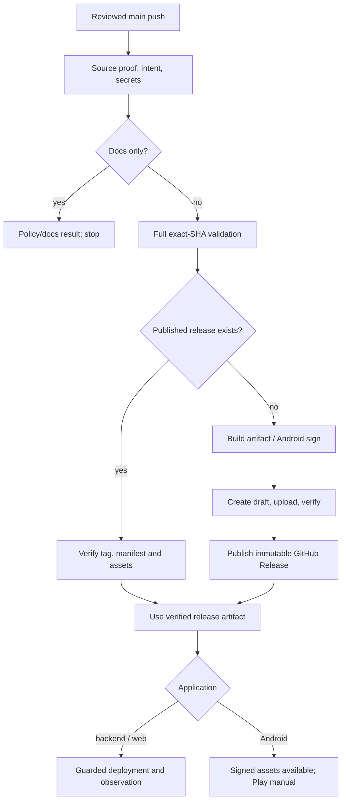

# Blogpost GitHub Actions CI/CD guideline

Approved interview decisions, 25 October 2026. Implement this alongside [VCS_GUIDELINE.md](VCS_GUIDELINE.md). This document specifies the future pipelines; no workflow, secret, signing key, repository setting, or GCP resource has been created by writing it.

[BUILD_VARIANTS_PLAN.md](BUILD_VARIANTS_PLAN.md) extends this guideline with local Docker Development, RC Staging, main Production, all six Android combinations, and the authoritative staging-evidence/promotion rules. Staging and Production are independently built and isolated in separate GCP projects.

The three independent repositories are [backend](https://github.com/oriorasajambu/blogpost-backend), [web](https://github.com/oriorasajambu/blogpost-web), and [Android](https://github.com/oriorasajambu/blogpost-android). All normal work goes through reviewed PRs to `rc`; only a reviewed same-repository `rc` → `main` promotion can release. Each application starts at `0.1.0` and uses independent `vX.Y.Z` tags.

## 1. Delivery policy and authority

| Concern              | Agreed behavior                                                                                                                                  |
| -------------------- | ------------------------------------------------------------------------------------------------------------------------------------------------ |
| Workflow events      | Only branch `push` and `pull_request`                                                                                                            |
| PR review            | Solo owner inspects and manually merges; checks/conversations required, zero mandatory independent approvals                                     |
| Release selection    | Explicit reviewed version bump and `publish: true` marker                                                                                        |
| Docs-only promotion  | `publish: false`, unchanged version; current-RC staging verification/equivalence and manual evidence still gate promotion; no production release |
| Publication order    | Build/test → immutable GitHub tag/release → deployment                                                                                           |
| Backend/web delivery | RC: staged image digest to Staging; main: published release digest to Production                                                                 |
| Rollout              | Zero-traffic candidate → smoke checks → 100% traffic → bounded observation → rollback on defined failures                                        |
| Database             | Backup, reviewed compatible migrations, schema verification; no automatic destructive migration or down migration                                |
| Android delivery     | RC staging APK on Actions artifacts; main Production APK/AAB on GitHub Releases; Play upload manual                                              |
| Retry                | Re-run the existing failed run at its original SHA; verify/reuse existing artifacts                                                              |
| Environments         | Local Docker Development plus separate Staging/Production GCP projects and databases in Jakarta                                                  |

This policy replaces manual-only normal backend/web releases. Retain [BACKEND_DEPLOYMENT_GUIDE.md](BACKEND_DEPLOYMENT_GUIDE.md) and [FRONTEND_WEB_DEPLOYMENT_GUIDE.md](FRONTEND_WEB_DEPLOYMENT_GUIDE.md) for initial provisioning and controlled recovery. Do not configure a second automatic Cloud Build/Cloud Run repository trigger. Console recovery actions must be recorded so a later workflow detects the actual live state.

[API_CONTRACT_V1.md](API_CONTRACT_V1.md) governs compatibility, envelopes, metadata, idempotency, and concurrency. App SemVer, contract SemVer, API `/v1`, Android version code, resource version, and Markdown version remain distinct.

## 2. Workflow events, required checks, and execution identity

### 2.1 Three workflow files per repository

Implement `.github/workflows/ci.yml` for development checks. This is its event/concurrency specification, not a complete runnable workflow:

```yaml
name: CI
on:
  push:
    branches:
      - 'feature/**'
      - 'bug/**'
      - 'chore/**'
      - 'docs/**'
  pull_request:
    branches: [rc, main]
    types: [opened, synchronize, reopened, ready_for_review, edited]
permissions:
  contents: read
concurrency:
  group: ci-${{ github.event_name }}-${{ github.event.pull_request.number || github.ref }}
  cancel-in-progress: true
```

Implement `.github/workflows/staging.yml` for RC checks, staging deployment/artifacts, and current-candidate evidence. This is an event/concurrency specification:

```yaml
name: Staging candidate
on:
  push:
    branches: [rc]
permissions:
  contents: read
concurrency:
  group: staging-${{ github.repository }}
  queue: max
  cancel-in-progress: false
```

RC checks run in this workflow rather than a duplicate `ci.yml` push. Implement `.github/workflows/release.yml` for main checks and the complete production release/deployment chain:

```yaml
name: Main release
on:
  push:
    branches: [main]
permissions:
  contents: read
concurrency:
  group: release-${{ github.repository }}
  queue: max
  cancel-in-progress: false
```

Keep tag pushes excluded through branch-only filters. Do not add `schedule`, `release`, `workflow_dispatch`, `workflow_run`, `workflow_call`, `repository_dispatch`, `pull_request_target`, or `merge_group`. Share scripts/composite actions without introducing another workflow trigger. A manual Actions **Re-run jobs** action retries an existing event and is permitted. The application's daily Cloud Scheduler retention job is separate from CI workflow events.

PR updates need `synchronize`, not just `opened`, so new commits are tested. Push and PR checks intentionally both run: the former validates the branch SHA, the latter validates the merge result with the current base. [PR event behavior](https://docs.github.com/en/actions/reference/workflows-and-actions/events-that-trigger-workflows)

Do not use workflow-level path filters. Classify changes inside a job so `ci-gate` always appears, even when code jobs are unnecessary. GitHub can otherwise leave a required check pending for a filtered-out workflow. [Workflow triggering](https://docs.github.com/en/actions/how-tos/write-workflows/choose-when-workflows-run/trigger-a-workflow)

### 2.2 Policy and aggregate gate

Every validation run first checks branch/PR policy, file restrictions, release metadata consistency, secret scanning, and change classification. On PRs it verifies the base/head repository and names:

- Allowed normal PR: valid `feature/`, `bug/`, `chore/`, or `docs/` source → `rc`, including forks.
- Allowed synchronization PR: same-repository `main` → `rc`.
- Allowed promotion PR: same-repository `rc` → `main`, merge-commit policy, valid release intent.
- A draft PR is not merge-ready, even if its test jobs pass.

Use one stable PR-only aggregate job named **`ci-gate`**, required on both permanent branches. It runs with `always()` after all policy and selected validation jobs, fails for required failed/cancelled/missing jobs, and accepts skips only when the classifier explicitly selected the docs-only path. It must not turn an unexpected skipped code suite into success. Work pushes use `push-gate`, RC uses `staging-evidence`, and main uses a release validation result, so an unrelated push check cannot satisfy promotion-specific requirements.

On `rc` → `main`, this gate also verifies the trusted current-RC staging receipt, live metadata/artifact agreement, and owner's recorded manual validation. Docs-only candidates use explicit input/configuration equivalence; an earlier SHA's bare green check is insufficient. See the variant plan's promotion-evidence procedure. PR checks use read-only GitHub APIs/public health; they receive no cloud or signing credential.

The main release workflow performs equivalent policy checks on the actual main SHA. A source-proof job must find the associated merged PR and verify all of:

1. Base is this repository's `main`; head is this repository's `rc`.
2. GitHub reports it merged and its `merge_commit_sha` equals the event SHA.
3. The commit has the expected merge ancestry; the promotion did not use squash/rebase.
4. Release intent, version, and changed files agree with the previous main state.
5. The resulting main source tree matches the approved RC tree, and staging/manual evidence is still valid before publication. Rebuild with Production inputs; do not claim its bytes match Staging.

Fail closed if the PR association is unavailable; retry the same run after a transient API failure. Do not infer authorization from commit wording or actor name. The initial repository root commit has no such PR and is explicitly non-releasing. Check out the immutable event SHA, never whatever `main` points to later. Use sufficient Git history for ancestry/version checks.

### 2.3 Concurrency and cancellation

CI may cancel superseded checks for the same event/branch. Staging and Production each use a separate serial group per repository and are never cancelled just because a newer push arrived. Current GitHub Actions supports `queue: max`; ordering follows arrival at the concurrency group and does not guarantee source-commit order. Add environment-scoped deployment ancestry checks regardless of the queue. [Concurrency specification](https://docs.github.com/en/actions/reference/workflows-and-actions/workflow-syntax)

Before mutating production, compare the candidate with recorded successful deployments and actual live Cloud Run revision labels. If a newer descendant already succeeded, mark the candidate deployment **skipped as stale**. Refuse unrelated or ambiguous histories for operator investigation. Repeat the check immediately before traffic switching. A rerun cannot downgrade production automatically. Publishing an older missing release may resume, but it must not replace the newest release's `latest` designation.

Normally wait for the previous release/deployment to settle before merging another promotion. This limits simultaneous work, while guards still handle accidental overlap and reruns. Backend and web pipelines serialize independently; API compatibility makes their independent order safe.

## 3. Change classification and release metadata

Use the `.release/release.json` schema and version sources defined in the VCS guideline. Validate it on work PRs and enforce promotion semantics on `rc` → `main` and main pushes. Never bump versions or commit generated release notes from the release workflow.

The documentation allowlist initially consists of README, license text, ordinary documentation Markdown under `docs/`, and the existing planning `.md` files other than the authoritative `API_CONTRACT_V1.md`. Accompanying documentation-only images are allowed after size/secret checks. Files consumed by the build/runtime, executable documentation snippets used as scripts, `.github/**`, `scripts/**`, authoritative contract documents, API schemas/fixtures, Dockerfiles, dependency files, Gradle files, and migrations always select code checks. Unknown paths select code checks.

For a docs-only promotion, allow `.release/release.json` only to change `publish` to false; application/version/contract pin and Android version code stay unchanged. A new marked release must strictly increase the application version over the preceding main state and earlier published tags/codes. A verified rerun may encounter its own tag or published release: accept only its matching original SHA/manifest and reuse it, rather than failing the monotonic-version check or treating it as a new release. First release is `0.1.0`; the bootstrap `0.0.0` is never tagged. A new runtime change cannot use the docs-only exception.

Prepare an immutable `release-manifest.json` containing:

```json
{
  "schemaVersion": 1,
  "application": "backend",
  "version": "0.1.0",
  "tag": "v0.1.0",
  "sourceSha": "FULL_MAIN_MERGE_SHA",
  "apiMajor": 1,
  "contractVersion": "1.0.0",
  "contractSha256": "CONTRACT_PACKAGE_SHA256",
  "imageDigest": "REGISTRY_IMAGE@sha256:IMAGE_SHA256",
  "workflowRunId": "RUN_ID",
  "artifacts": []
}
```

Values in capitals are placeholders to be generated/verified by implementation. Artifact entries contain filename, media type, size, and SHA-256. Android adds application ID, version code, signing-certificate SHA-256, and APK/AAB entries; it has no image digest. Backend adds migration IDs/checksums and the supported schema compatibility range. Do not put secrets, session values, environment dumps, or staff information in public manifests.

The manifest describes the artifact permanently. Deployment records describe where it ran and whether rollout succeeded; do not mutate release assets to append deployment results.

Add artifact `environment`, normalized `runtimeInputDigest`, and the tested RC receipt/reference to Production manifests. Actual runtime configuration digest/revision belongs in deployment records. Staging uses its own manifest/receipt on Actions artifacts, not a GitHub Release. Application versions and Android codes follow the environment-specific rules in the variant plan.

## 4. Validation matrix

Use standard GitHub-hosted runners. Pin runner OS labels, action commit SHAs, package/tool versions, and lockfiles in reviewed source. At implementation kickoff record the exact known-good versions rather than copying floating action tags into the final workflows.

| Area                                               | Work push / code PR                           | Marked main release                                 |
| -------------------------------------------------- | --------------------------------------------- | --------------------------------------------------- |
| Policy, forbidden files, secrets, release metadata | Required                                      | Required again at exact main SHA                    |
| Markdown/local links                               | Changed docs                                  | Changed docs                                        |
| Lint, types, unit tests                            | Required                                      | Required                                            |
| Dependency/security checks                         | Required; reviewed bounded exceptions         | Required; expired exceptions fail                   |
| Contract/schema compatibility                      | Required where relevant                       | Required; supported-client baselines                |
| Backend PostgreSQL integration                     | Required for backend code                     | Required                                            |
| Web browser journeys                               | Focused Chromium suite                        | Full core journey suite and production build checks |
| Android emulator                                   | Focused minimum-supported API suite           | Minimum + target API release-focused suite          |
| Release artifact validation                        | Unsigned/local production build as applicable | Exact artifacts to publish                          |
| Signing / production identity                      | Never                                         | Trusted main jobs only                              |

Docs-only runs still execute policy, history/path secret checks, marker classification, Markdown, and local-link checks. Do not add meaningless coverage percentages or repeat exhaustive tests after no code changed. A changed test/tool/workflow is a code change. Missing infrastructure or an unavailable required SDK fails the affected check; it is not silently waived.

RC code pushes run the relevant full suites against Staging build inputs, then guarded staging delivery. RC docs-only pushes still verify current-candidate staging equivalence/live state and publish a receipt. Automated shared-staging checks are read-only; real Google sign-in/editorial mutations belong to the owner's promotion checklist. Production repeats full validation on its newly built main artifact.

### 4.1 Backend

Use Node.js 24 LTS at a reviewed patched version, locked npm dependencies, NestJS, Prisma 7, and a disposable PostgreSQL 17 service. Test credentials are synthetic and never point to Cloud SQL.

Run formatting/lint, TypeScript checks, unit rules, production compilation, and integration tests against real PostgreSQL. Test migrations from an empty database and the previous supported deployment schema; validate runtime/migrator grants. Exercise immutable revisions, last-admin races, review-and-publish races, author isolation, idempotency/response-loss recovery, staged media, search visibility, and withdrawal.

Validate design-first OpenAPI 3.1.2 and all examples, compare with supported published contract baselines, compile generated Web/Android consumers, and run mock/provider conformance. Automated OpenAPI differences need semantic review for defaults, ordering, auth, retries, and full-draft-save compatibility. [OpenAPI change checks](https://www.oasdiff.com/docs/breaking-changes)

Test the wrapped success/error invariants, status agreement, binary exceptions, all five required headers, `X-Expected-Version`/`X-Resource-Version`, unknown error/action behavior, and the invitation receipt-only replay exception. Never reinstate the superseded Problem Details or strong ETag conventions.

### 4.2 Web

Use the locked Node/Next.js/React versions from the web plan. Run lint, types, unit/adapter tests, a production Next.js build, and Playwright core journeys against the versioned stateful mock or real local API. Full main checks include at least one real local API journey; no production staff database is used.

Cover public SSR before JavaScript, metadata/SEO, empty/search/error states, visitor ID creation without persistent storage, required metadata on SSR/BFF/image requests, HttpOnly session and CSRF handling, draft preservation during request loss/conflicts, review/publish, and withdrawal. Include focused automated accessibility checks and provide manual keyboard/font/theme evidence when UI changes. Verify no server credentials or private drafts appear in public HTML, browser bundles, source maps, or test artifacts.

A public `NEXT_PUBLIC_*` value is build-time public configuration, not secret storage. Build each cloud artifact with its reviewed Staging or Production public configuration; runtime server settings remain external. Both optimized environments use `NODE_ENV=production` and the matching `APP_ENV`. Avoid depending on a live public API during image construction. Server-only backend calls start at runtime with `no-store` behavior as specified by the product plans.

### 4.3 Android

Reuse the inspected scaffold's Gradle wrapper, version catalog, Retrofit/OkHttp/Gson instance, and module structure. Record a verified compatible CI JDK, initially JDK 21 for its current AGP/Gradle, without changing Java source compatibility simply to match the build JDK. Verify wrapper distribution checksum and lock/verify dependencies.

Run static/import/KDoc checks appropriate to the repository, Android lint, domain/repository/ViewModel tests, production-variant compilation, and Android test-source compilation. Resolve real module/task names during scaffold import; do not invent task names that CI never executes. Baseline commands include `./gradlew build`; select the actual connected/managed-device tasks after the focused test suite exists.

Run focused instrumentation on API 29, the planned minimum. Marked main releases also exercise the actual target API image (currently planned API 37, minor SDK configuration as required by the scaffold), plus a release-variant network/rendering/upgrade check. Confirm SDK/image availability and AGP compatibility during setup. Test process death separately from Activity recreation, Room migrations, offline drafts, version conflicts, cached withdrawal, TalkBack/font scaling, and decoding unknown critical enums into a safe read-only state.

Keep all six Android combinations enabled and compile/test them without signing secrets. `developmentDebug`/`developmentRelease` use local emulation; `stagingDebug`/`stagingRelease` use staging identity; `productionDebug` is anonymous/read-only and undistributed; only `productionRelease` gets normal production staff access. See the six-ID matrix in the variant plan. Staging/Production bundles reject mock/emulator controls, private body capture, local cleartext trust, and template identities. Development Release is intentionally local and is not a Production release. Real Google sign-in is manually rehearsed with each distributed variant's certificate; mock success cannot prove provider configuration.

## 5. Security boundaries and credentials

### 5.1 Fork and development CI

Fork PRs run with read-only permissions, no repository/environment secrets, no signing key, no OIDC permission, and no production network identity. Use GitHub's first-time-contributor execution approval controls. Never switch to `pull_request_target` to make secrets available. Do not execute fork artifacts in a privileged later workflow. Isolate trusted release caches from untrusted PR cache writes.

Default `contents: read`; grant `pull-requests: read` only where policy needs it. Use `persist-credentials: false` for checkouts. Treat PR titles, branch names, and changed filenames as untrusted data: pass them as data, never interpolate them into shell scripts. Pin third-party actions by full reviewed commit SHA and minimize their access. [Actions security guidance](https://docs.github.com/en/actions/reference/security/secure-use)

Job permissions on trusted RC/main (always scoped to the selected environment):

| Job                                        | Additional permissions / access                                               |
| ------------------------------------------ | ----------------------------------------------------------------------------- |
| Validation/build without external identity | No write token; no application secrets                                        |
| GCP image publication                      | `id-token: write`; RC staging builder or main production builder              |
| GitHub Release publisher                   | Main only, `contents: write`; artifact inputs only                            |
| Cloud deployment                           | `id-token: write`, `deployments: write`; matching staging/production deployer |
| Android signing                            | RC staging key or main production key, artifact inputs only; no GCP identity  |

The Android RC artifact-recording job also uses `deployments: write` to persist code/certificate/digest continuity beyond artifact expiry. Keep this separate from signing where practical; it needs no cloud identity or `contents: write`.

Each explicit job permission block must also declare the required `contents: read` (or publisher's `contents: write`); unspecified permissions become unavailable rather than automatically inheriting the workflow defaults. Grant `pull-requests: read` to the source-proof job, `actions: read` to jobs inspecting retained run artifacts, and deployment read access to jobs checking previous deployments. Grant no other permissions merely for convenience.

Do not grant write-all or keep a broad personal access token for routine releases. The built-in token can publish the tag/release in the same run. Its generated events do not start an additional release workflow; this chain does not depend on one. [Token-trigger behavior](https://docs.github.com/en/actions/how-tos/write-workflows/choose-when-workflows-run/trigger-a-workflow)

### 5.2 Forbidden files and secret checks

Reject tracked `.env` and `.env.*` basenames case-insensitively at every depth, except exact `.env.example`. Scan the current tree **and all introduced commits**, so adding then deleting a secret in one PR still fails. Validate the allowed template against placeholder rules and scan it too. Ignore rules are convenience, not enforcement.

Use a pinned secret scanner with redacted output and enable GitHub secret scanning/push protection where available. Reject actual keystores, signing passwords, service-account keys, production connection strings, and credential exports. Keep temporary OIDC credential files such as `gha-creds-*.json` out of Git, Docker contexts, caches, and upload artifacts. The Google auth action may create these in the workspace; use explicit ignore rules and cleanup. [Google auth action](https://github.com/google-github-actions/auth)

Release uploads use a filename allowlist, not a workspace archive or recursive wildcard. Scan container layers/build history and artifacts for credential leakage. High/critical actionable vulnerabilities block release; any unrelated false-positive/temporary exception needs a reviewed reason, scope, owner, and expiry. Never waive the actual `.env`/private-key prohibition.

### 5.3 Short-lived GCP identity

Use GitHub OIDC → Google Workload Identity Federation → dedicated service-account impersonation. Do not store a GCP service-account JSON key in GitHub. Production trust checks the issuer `https://token.actions.githubusercontent.com`, audience, numeric owner/repository IDs, `refs/heads/main`, event `push`, and exact `.github/workflows/release.yml@refs/heads/main` reference. Independent staging-project trust checks `refs/heads/rc` and `.github/workflows/staging.yml@refs/heads/rc` instead. Both check the intended job environment; map every referenced claim. [GCP deployment federation](https://docs.cloud.google.com/iam/docs/workload-identity-federation-with-deployment-pipelines)

Verified identity worksheet:

| Identity              | Numeric ID   |
| --------------------- | ------------ |
| Owner `oriorasajambu` | `69578296`   |
| `blogpost-backend`    | `1433164464` |
| `blogpost-web`        | `1433164881` |
| `blogpost-android`    | `1433165204` |

Android receives no GCP deployment trust. Recheck IDs before configuration, particularly after any repository transfer. Numeric IDs protect against a deleted repository name being reused by another identity.

Create backend/web environments `staging-build` and `staging`, restricted to `rc`, plus `production-build` and `production`, restricted to `main`. Android has RC-only `android-staging-signing` and main-only `android-signing`. No additional required human environment approval follows a main merge: review and recorded validation happen in the promotion PR. Bind the matching repository/environment/ref in federation; an environment-shaped `sub` does not replace the branch check. [OIDC environment claims](https://docs.github.com/en/actions/concepts/security/openid-connect)

For a shared pool, map a combined identity attribute such as `repository_id:environment` and bind each account to that exact combination. Two separate allowlisted principal sets for repository and environment would grant either group access, rather than enforce both together. Test that backend build identity cannot impersonate its deploy account or the web accounts.

Use proposed accounts `blogpost-backend-ci-build`, `blogpost-backend-ci-deploy`, `blogpost-web-ci-build`, and `blogpost-web-ci-deploy` independently in each project; these are setup names, not existing resources. Retain project-local runtime accounts `blogpost-api`, `blogpost-web`, `blogpost-migrate`, and `blogpost-ops`. Identical basenames in different projects do not imply shared identities or grants.

| Identity                                | Resource-scoped grants / purpose                                                                                                                       |
| --------------------------------------- | ------------------------------------------------------------------------------------------------------------------------------------------------------ |
| Builder                                 | Artifact Registry Writer on Docker repository `blogpost`; no Cloud Run deploy or SQL access                                                            |
| Deployer                                | Cloud Run Developer on its pre-created service/jobs; Artifact Registry Reader; Service Account User only on the runtime accounts it must attach        |
| Backend backup function within deployer | Custom permissions to create/read/list Cloud SQL backups and inspect instance/operation status; scope to the intended project/instance where supported |
| Observation within deployer             | Read the necessary Cloud Run/Monitoring metrics and deployment logs, without secret payload access                                                     |
| Runtime/migration accounts              | Existing Cloud SQL/Secret Manager/storage grants from the backend plan; never inherited by the GitHub build job                                        |

Grant Workload Identity User on each intended impersonated account, not a broad project-wide impersonation role. Within each project, one Artifact Registry repository gives its builder access to both backend/web packages; the Staging and Production registries are separate. No cross-project cloud grants, Owner/Editor role, SQL root password, or production `.env` is needed in Actions.

Test each provider with its allowed ref and rejection cases: PRs, wrong repository/environment/workflow, RC attempting Production, and main attempting Staging. A YAML `if` alone is not the cloud trust boundary. Reviewed RC has staging deployment authority only; main has production authority. Workflow/dependency changes therefore receive the same careful review as application code.

Acquire cloud credentials just before their phase, rather than before a long build. Support reauthentication during backup/job polling and observation, and refresh registry credentials before pushing. Short-lived credentials must not be assumed to last for the whole release job. Record operation IDs before waiting so credential expiry or a runner timeout can be reconciled without duplicating the operation. [Credential lifetime considerations](https://github.com/google-github-actions/auth)

## 6. Build once, publish once

Build once **per source/environment release**, not one binary for both cloud environments. Staging builds from RC, deploys to staging or publishes its signed APK to expiring Actions artifacts, and writes the trusted verification receipt. It creates no GitHub tag/release. Docs-only RC candidates run the explicit equivalence/live-verification path. Production uses the following main-only publication graph and fresh Production configuration.

### 6.1 Common release job graph



The main release path repeats the required checks on the actual merge SHA. Never release solely because an earlier PR run passed on a different synthetic commit. Before creating artifacts, check for an existing immutable release and follow the retry rules in section 9.

### 6.2 Backend and web images

Build Linux/amd64 production images from the exact SHA with locked dependencies and reviewed base-image digests. Unit/integration testing is separate from the minimal runtime image. Scan the resulting image and produce a software bill of materials. The build context excludes all local/temporary credential files.

Push images to `asia-southeast2-docker.pkg.dev/PROJECT_ID/blogpost/backend` or `/web`, initially using a unique `sha-FULL_SHA` reference. Resolve and record the registry digest. Never deploy a floating `latest` or rebuild the same version during deployment. Preserve the digest as a release artifact and prevent cleanup of any image referenced by an extant release or rollback revision.

GitHub Release assets include `release-manifest.json`, checksums, SBOM, and validation/compatibility summaries. Backend also publishes the frozen OpenAPI YAML/JSON, Markdown contract, shared fixtures/mock package, and migration manifest/bundle. Runtime image bytes remain in Artifact Registry; the public release need not include a Docker tarball.

Clients pin the backend release location, contract semantic version, and checksum in a committed contract lock. The archive name includes the contract version. Normalize file order, timestamps, and archive metadata so contract packaging is deterministic; keep app-specific build identifiers outside it. Reuse the canonical package when that contract version is unchanged. A contract change receives the appropriate new contract version. Do not rename app tags to look like contract-version tags. Development PR artifacts can support parallel work, but production client pins use an immutable reviewed contract package.

### 6.3 Production Android signing and artifacts

This section describes main's `productionRelease`. RC signs only `stagingRelease` with its independent stable staging key and uploads an APK/report/manifest as Actions artifacts. See the variant plan for all six IDs, staging codes, and unsigned verification-only combinations. Neither Production Debug nor Staging Debug is distributed by CI.

Before the first real release, select the final application ID, generate or identify the intended self-managed app-signing identity, record its certificate SHA-256, and verify secure offline backups and password recovery. Do not generate a new identity on every run. Configure the corresponding Identity Platform/Firebase fingerprints and App Links.

Use one identity for GitHub APKs and the initial signed AAB. Keep the encrypted keystore material and passwords in the `android-signing` environment, accessible only from trusted main. Base64 encoding is a transport format, not encryption. Protect the original with secure offline backups; no actual key belongs in Git.

Separate unsigned release build/testing from signing:

1. Build and validate unsigned APK/AAB with no signing secrets. Record source/toolchain/version metadata and artifact hashes.
2. In a dedicated fresh signing job, download only that run's verified unsigned artifacts. Do not execute repository Gradle/build scripts after exposing the key. Use pinned Android/JDK signing tools and runner-temporary files with cleanup on success/failure.
3. Align APK if needed, sign it with `apksigner`; sign the AAB using the appropriate JAR signing tool. Supply passwords without logging them or expanding them into diagnostic command output.
4. Verify signatures, package ID, version name/code, certificate fingerprint, and release configuration. Test installing/upgrading the signed APK over the previous signed release when available; use synthetic local data.
5. Publish `blogpost-android-X.Y.Z.apk`, `blogpost-android-X.Y.Z.aab`, checksums, manifest, SBOM, and R8 mapping when applicable. Do not publish key material or runner credential files.

An AAB is a distribution bundle, not an installable APK. A later Play enrollment must import/preserve this same app-signing identity if Play-installed apps are to match GitHub-installed apps. A separate Play upload key may then sign uploads; configure that distinction before store distribution. Do not silently choose a different Play-generated app-signing key. [Android signing model](https://developer.android.com/studio/publish/app-signing)

### 6.4 Tag and GitHub Release publication

After all artifact checks, create annotated `vX.Y.Z` at the exact main SHA. Verify an existing tag peels to that SHA; otherwise stop. Create a draft release, upload the complete asset allowlist and checksums, verify the downloaded assets, then publish it. Enable GitHub immutable releases before the first publication. Published assets/tag are fixed; GitHub also creates a release attestation. [Immutable publication](https://docs.github.com/en/code-security/concepts/supply-chain-security/immutable-releases)

Release notes explain behavior changes, compatibility, configuration/migrations, and known limitations. Link the Actions run. Make deployment state visible through GitHub deployment records and the run summary, not by replacing immutable files. Do not delete a published release because production deployment failed.

## 7. Automatic GCP deployment

### 7.1 Preconditions and shared rollout rules

Bootstrap each selected project with its own Artifact Registry `blogpost`, Cloud SQL `blogpost-db`, private bucket, Identity Platform, secrets, accounts, services, and jobs through the Console guides. Staging uses reviewed RC source. Production uses main-built artifacts only: if its first run publishes successfully but encounters missing initial services, fail deployment closed, bootstrap through the Console from those published digests, then rerun that original run. Record a verified initial revision before normal automatic rollouts; never substitute an RC-built Production image. See the variant plan's bootstrap sequence.

Keep the existing region `asia-southeast2`, Cloud Run resource/pool limits, secret references, SQL attachments, and stable origins. Image deployment must preserve these settings and fail when required configuration is absent. Do not have a generic deploy command replace the entire service with incomplete defaults.

For every release, record before changing anything:

- Source SHA, application version, release URL, image digest, and workflow attempt.
- The actual previous traffic map using explicit revision names, previous image digests, and relevant configuration generation.
- Current schema/contract state and any newer successful deployment.
- Candidate revision/tag, backup and migration execution IDs, and probe results as they become available.

Deploy the fixed digest as a named revision with zero production traffic and a temporary revision tag. Verify the service's traffic map still points to the previous explicit revision; never leave a floating `latestRevision` target that would direct traffic prematurely. On retry, reuse an existing candidate only after its source/digest/configuration match; otherwise create a new attempt revision without overwriting live state. A tagged URL may still be publicly reachable; zero allocated traffic is not access control. Production auth rules and disabled mock controls apply there too. [Cloud Run traffic control](https://docs.cloud.google.com/run/docs/rollouts-rollbacks-traffic-migration)

Staging and Production have separate databases/projects. Candidate checks in either shared cloud environment are bounded and read-only; the owner performs staging editorial validation with synthetic content. Full automated editorial/migration races use disposable local CI services. Do not publish test articles, accept fixture credentials, or run shared-staging test writes against Production.

### 7.2 Backend backup and migration sequence

After the GitHub Release is published and stale-run checks pass:

1. Read actual deployed schema and migration history. Validate the reviewed migration manifest, checksums, compatibility classification, and expected predecessor. If a required predecessor deployment/migration was skipped, validate and apply the complete pending compatible chain; do not assume queue order applied it.
2. Create an on-demand Cloud SQL backup identified by repository and source SHA. Wait for confirmed successful completion before migration. A daily backup alone does not satisfy this gate. On rerun reuse the recorded successful backup only if it belongs to the same schema-mutation attempt; create a fresh backup before any new pending mutation. [Cloud SQL backup operations](https://docs.cloud.google.com/sql/docs/postgres/backup-recovery/manage-standard-backups)
3. Execute a pre-created migration Cloud Run Job using the released image digest and existing `blogpost-migrate` runtime identity. Run `dist/ops/migrate.js` with an advisory lock, bounded lock/statement timeouts, and the migration role's Secret Manager references. Actions receives execution status, not the SQL password.
4. Verify migration checksums/history and run `dist/ops/verify-db.js`. Confirm schema/search/grants and that the application role cannot perform DDL. Stop if either job fails. Never start bootstrap-admin or bootstrap-root tasks from the release pipeline.
5. Create the API candidate revision with the same image digest and production configuration. Run read-only candidate probes described below; only then switch traffic.
6. After successful observation, update compatible maintenance/verification job image references as planned. Retention jobs coordinate with the migration lock and skip/retry bounded work rather than racing schema changes.

Only reviewed **expand-compatible** changes can run automatically: for example a new optional column/table and bounded index work proven against the old code. SQL/schema-diff checks plus human migration review must reject drops, renames, type narrowing, destructive data changes, risky large rewrites, and newly required values without a compatible phased strategy. A `safe: true` label alone does not prove safety.

Both the previous serving revision and the new candidate must work after migration. Do not run down migrations during rollback. If migration state is uncertain or partially applied, retain current traffic and investigate/reconcile with the same migration system. Restore a backup only under a separate recovery procedure that accounts for writes since the backup; it is never an automatic traffic rollback action.

Keep daily standard backups (initially seven) and restore drills. Retain release-created backups for at least 30 days and at least the latest five release backups. Review/clean up positively identified expired pipeline backups through the Console, outside the critical rollout; the CI backup identity needs no deletion permission. Track their storage cost. Budget alerts are notifications, not a spending cap.

These are Production retention defaults. Staging uses three daily backups plus pre-migration backups retained for at least seven days/last three attempts, with the same compatible-migration and guarded-reset rules. Apply the sequence in the staging project after staging artifact publication; it does not wait for or create a GitHub Release.

### 7.3 Candidate probes and promotion

Backend candidate checks:

- Startup/liveness and SQL-dependent readiness, bounded for cold starts.
- `/v1/meta` with all five metadata headers; expected build identifier, envelope, contract capabilities, and actual response headers.
- Public list/search/slug resolution using known safe inputs; a seeded public read-only fixture if available, otherwise empty/not-found is valid as specified.
- Anonymous protected-resource access is denied correctly; no production fixture-auth bypass.
- A known public image/withdrawn reference when safely available, validating media authorization without changing data.

Web candidate checks:

- Health/readiness and public SSR HTML before JavaScript; expected build identifier.
- Backend connectivity, mandatory headers on server/media calls, supported API contract/capabilities, and no private payload/secret leakage.
- Public navigation, canonical production URLs, no-store policy, asset delivery, and expected anonymous staff/login behavior.

Candidate web origins differ from the stable web origin. Do not weaken CSRF, cookie origin, or OAuth redirect restrictions to enable a live login test at a tagged URL. Local/provider rehearsals cover authentication before release; stable-origin checks after switching verify configuration without storing a human staff refresh token in CI.

Allow up to five minutes for candidate startup/readiness with bounded backoff. Require three consecutive passing probe rounds before promotion; otherwise fail without moving traffic. Once ready, recheck ancestry/live state and move service traffic to **100% of the explicit candidate revision**. Do not use a percentage canary for this small audience. Preserve the pre-rollout traffic map for rollback.

Observe for 15 minutes after routing converges. Run read-only synthetic probes every 30 seconds and inspect service metrics. Observation is part of the existing matching RC/main-push run, not a new scheduled workflow.

| Failure during observation                                                      | Action                                                                                              |
| ------------------------------------------------------------------------------- | --------------------------------------------------------------------------------------------------- |
| Two consecutive failed probe rounds after initial bounded routing convergence   | Restore recorded previous traffic map                                                               |
| Required envelope/contract/build invariant fails in two confirmed rounds        | Restore previous traffic map                                                                        |
| Service 5xx rate exceeds 5% over a five-minute window with at least 20 requests | Restore previous traffic map                                                                        |
| Latency alone, without the defined availability/contract failure                | Report for investigation; cold-start budget is accepted                                             |
| Metrics unavailable, but synthetic checks healthy                               | Mark observation incomplete, fail deployment result, retain current traffic for operator assessment |

Traffic updates are not instantaneous and in-flight requests can finish on an earlier revision. Probe logic must allow a bounded convergence interval before judging build identity. If rollback is triggered, verify the previous revision becomes healthy and record `rolled_back`; deployment is still failed. If rollback fails, report the actual live map and stop further automatic rollout. [Traffic transition behavior](https://docs.cloud.google.com/run/docs/rollouts-rollbacks-traffic-migration)

Automatic rollback covers this observation window. Cloud Monitoring alerts remain configured afterward for operational response; this plan does not add a scheduled GitHub monitor. Configure liveness to detect process failure, not to restart healthy processes merely because SQL is briefly unavailable. [Cloud Run health checks](https://docs.cloud.google.com/run/docs/configuring/healthchecks)

Keep rollback in a guarded recovery job that runs after a failed observation job, with its own timeout and the previously persisted traffic record. Reserve enough workflow time for recovery; do not rely solely on a cleanup step in a job that can time out. If the runner or cloud control plane is unavailable, automatic rollback cannot be guaranteed. The operator uses the Console recovery guide and records the resulting live state before a rerun.

### 7.4 Web/backend compatibility during independent rollout

Deploy backend support before a client depends on a new capability. Web/Android releases pin the contract but check actual server capabilities; unsupported features remain hidden or read-only according to the API contract. A client release cannot force an immediate backend major retirement.

Before web traffic switching, verify the live API's declared compatibility and required capabilities. Backend release checks include supported older client fixtures, and a backend rollback must still support already-distributed clients. Keep old endpoints/schemas for the contract's required overlap: at least 12 months after the replacement is production-ready on both clients, at least 90 days after notice, and any longer commitment.

For a breaking API major, use the explicit coexistence/migration plan. Do not coordinate a three-repository simultaneous cutover as a substitute for compatibility. Android users may remain on old versions for months; disabling functionality must preserve local draft export/recovery.

## 8. Setup worksheet and implementation order

Complete this before the first marked promotion; identifiers not already supplied remain deliberate setup inputs:

Maintain separate Staging and Production columns for every cloud input below. Staging must be ready before it can produce promotion evidence. Project-scoped accounts, secrets, URLs and SQL targets must never fall back across columns.

| Input                       | Value / source                                                                                        |
| --------------------------- | ----------------------------------------------------------------------------------------------------- |
| Repositories / numeric IDs  | Section 5; reverify current ownership                                                                 |
| GCP project IDs and numbers | Distinct Staging and Production projects; record actual values and budgets                            |
| Region                      | `asia-southeast2`                                                                                     |
| Registry                    | `blogpost`; exact backend/web image paths                                                             |
| Services                    | `blogpost-api`, `blogpost-web`; record stable HTTPS URLs and existing healthy revisions               |
| SQL                         | `blogpost-db`; actual instance connection name, database/schema `blogpost`                            |
| Jobs                        | Actual migrate/verify/maintenance job names and runtime accounts from bootstrap                       |
| Federation                  | Pool/provider resource names, mapped claims, audience, account emails, tested conditions              |
| Runtime secrets             | Secret Manager resource/version references only; never paste secret values                            |
| Web production config       | Stable origin, API URL, public Identity Platform config, reviewed build-time settings                 |
| Android identity            | Final application ID, signing alias/certificate fingerprint, backup owner/location; no passwords here |
| Toolchain                   | Exact Node/JDK/Gradle/SDK/action SHAs/scanner versions and verified runner images                     |
| Contract pin                | Backend release location, contract version, SHA-256, supported baselines                              |
| Checks                      | Exact `ci-gate` result, selected suites, report retention, successful setup runs                      |
| Recovery                    | Known-good revisions, restore drill result, rollback and key-recovery procedure                       |

Use explicit nonsecret GitHub variables such as `GCP_PROJECT_ID`, `GCP_PROJECT_NUMBER`, `GCP_REGION`, `GCP_WIF_PROVIDER`, `GCP_BUILD_SERVICE_ACCOUNT`, `GCP_DEPLOY_SERVICE_ACCOUNT`, `ARTIFACT_IMAGE`, `CLOUD_RUN_SERVICE`, and `API_BASE_URL`. Add only the values each repository/job needs. Runtime SQL/CSRF credentials remain Secret Manager references on the cloud services/jobs, not GitHub variables.

In each Android signing environment define `ANDROID_KEYSTORE_BASE64`, `ANDROID_KEYSTORE_PASSWORD`, and `ANDROID_KEY_PASSWORD` as secrets, with **different staging/production values**. Store `ANDROID_KEY_ALIAS`, `ANDROID_APPLICATION_ID`, and `ANDROID_SIGNING_CERT_SHA256` as nonsecret variables scoped to the matching environment. Add the reviewed staging code base separately. Preserve encrypted keystore bytes exactly; never print secret values.

Implementation sequence:

1. Bootstrap `main`/`rc`, ignore rules, version sources, PR templates, and source policy as described in the VCS guideline.
2. Implement secret-free CI and `ci-gate`; run a normal code PR, docs-only PR, and fork PR. Enable required checks only after names appear.
3. Add contract fixtures/mock and the real per-platform suites. Prove local PostgreSQL migration/permission invariants and Android SDK/tool compatibility.
4. Implement release-intent validation, manifest/checksums, exact-SHA image/unsigned Android builds, and idempotent draft publication. Enable immutable releases before any real publication.
5. Bootstrap GCP through the Console guides. Configure narrowly scoped federation, environments, runtime jobs/secrets, and record existing healthy revisions. Retain manual Cloud Build only as an explicitly invoked bootstrap/recovery path.
6. Configure Android signing offline backup and environment secrets. Verify certificate fingerprints, upgrade continuity, and provider configuration before signed publication.
7. Implement backup/migration/candidate/observation/rollback and deployment records. Rehearse on disposable local services and the initial controlled cloud rollout; no destructive test against production data.
8. Prepare reviewed `0.1.0` release PRs, manually promote independently, and record GitHub Release plus deployment results. Synchronize `main` into `rc` afterward.

Before step 8, complete the variant plan's RC workflow, staging infrastructure/key, evidence receipt, docs-equivalence, and owner-validation gates. A missing staging setup does not permit a production bypass; ordinary local Development remains available.

Do not set a deployment credential just to make a fork CI job pass. Missing production setup blocks release/deployment, not ordinary secret-free frontend development against the contract/mock.

## 9. Retry and failure runbook

In GitHub **Actions**, open the original main-push run and choose **Re-run failed jobs** after fixing a transient external/configuration issue. The source SHA stays fixed. A code fix requires a new reviewed version through `rc`; retry is not permission to execute different source under an old release.

Before resuming, load existing run artifacts, tag, draft/published release, release manifest, registry digest, job executions, and deployment record. Never assume a timed-out step failed before committing its external action.

| Observed state                                         | Required recovery                                                                                                         |
| ------------------------------------------------------ | ------------------------------------------------------------------------------------------------------------------------- |
| Checks/build failed before publication                 | Fix source via PR/new version when needed, or rerun exact SHA for a transient failure                                     |
| Tag exists at another SHA                              | Stop; never move/delete/reuse it                                                                                          |
| Partial draft release                                  | Verify source/manifest; resume only missing assets from the same verified build, then verify all before publication       |
| Published immutable release exists                     | Download/verify tag, manifest, checksums and image/signing identity; reuse it, skip rebuild/re-sign/re-upload             |
| Existing artifact checksum disagrees                   | Stop and investigate; create a new version for a real correction                                                          |
| Backup failed                                          | Leave traffic/schema unchanged; retry backup before pending migration                                                     |
| Migration failed or state uncertain                    | Leave traffic on previous revision; inspect execution/history, reconcile deliberately; no automatic down migration        |
| Candidate smoke failed                                 | Retain previous traffic, preserve published release, record failed deployment                                             |
| Post-switch failure                                    | Restore previous traffic map; verify rollback; keep release/tag and database migration                                    |
| Runner lost or workflow timed out after switching      | Inspect actual live traffic and probes; use Console rollback if needed, then reconcile the deployment record before rerun |
| Newer deployment already succeeded                     | Skip stale deployment; never roll it back from an older rerun                                                             |
| Signing key absent / wrong certificate                 | Fail before publication; restore the established identity, never generate a replacement silently                          |
| Rerun data/artifact needed for verification is missing | Stop; do not reconstruct unverifiable assets under an existing tag                                                        |

If an immutable release already exists, even **Re-run all jobs** must detect it before artifact creation and reuse verified release contents. Android signing can produce different bytes on a second run; never compare a newly signed binary by replacing the original. Use the published bytes as authority.

For an incomplete unpublished draft, if original verified build assets are unavailable, stop rather than mixing build attempts. Resolve the abandoned draft under an explicit operator procedure and release a new version if necessary; never replace published assets. For deployment reruns, inspect actual migration state and actual live traffic again, even if a previous job output claimed success.

Each deployment record includes release/SHA/digest, previous and candidate revisions, backup/migration IDs, smoke/observation outcomes, resulting traffic, and rollback result. Record `published`, `deploying`, `succeeded`, `failed`, `rolled_back`, or `skipped_stale` distinctly. Use GitHub deployment statuses and the Actions summary; report production failures separately from artifact publication.

These outcome descriptors belong to the pipeline's record schema; map them onto GitHub's supported deployment-status values rather than sending custom enum values to its API. For example a completed rollback reports deployment failure with `outcome=rolled_back`, not a fictitious native `rolled_back` status. [Deployment status API](https://docs.github.com/en/rest/deployments/statuses)

Keep ordinary CI reports for 30 days and release/deployment reports for 90 days within repository retention limits. Release assets/manifests are durable. Preserve current and rollback container digests; remove temporary candidate tags only when safe. Sanitize screenshots, HTTP traces, logs, and migration diagnostics before uploading.

## 10. Acceptance and rollout gate

The CI/CD implementation is ready when evidence demonstrates all of the following:

- Only the specified push/PR events exist; updated PR commits run fresh checks; required gates never remain pending from path filtering.
- Fork and ordinary work runs have no production/signing identity; wrong-repo/ref/workflow/environment federation attempts fail.
- Metadata, envelope, version, idempotency, contract pin, and unknown-value fixtures pass in both generated clients and the real backend.
- Actual `.env` variants and secrets are rejected, including nested, case-variant, and added-then-removed examples; sanitized templates pass.
- Docs-only promotion skips publication, while unversioned runtime changes fail.
- A reviewed main promotion produces one verified tag/release at its exact SHA; partial publication and same-SHA reruns behave safely.
- Images are deployed by the published digest; APK/AAB signatures, application ID, version code, and upgrade continuity are verified.
- Backup failure, blocked destructive migration, migration failure, candidate failure, post-switch rollback, and failed rollback have tested outcomes.
- A stale rerun cannot supersede a newer successful deployment; a published-but-undeployed release remains visible and immutable.
- Old-client compatibility and the real cross-platform editorial journey pass; mock success alone is insufficient.
- The owner can distinguish release publication from production health using the final run/deployment record.
- RC delivers only staging images/APK, never accesses Production credentials, and emits trusted current-candidate evidence; docs-only reuse is proven rather than inferred from a green check.
- All six Android combinations pass configuration checks; Production Debug remains anonymous/undistributed, and staging/prod package/key identities cannot collide.
- A promotion missing staging/manual evidence is blocked; a valid equivalent docs-only candidate can proceed without an application redeploy.

The deliverable at this stage is this plan. Workflow YAML, scripts, rulesets, federation, signing setup, and rollout execution are the subsequent implementation work, performed through the review process above.
