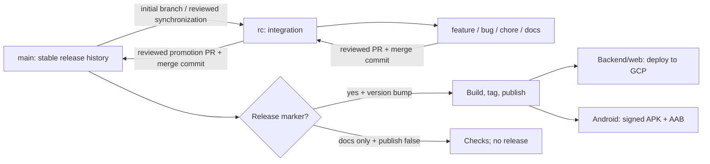

# Blogpost GitHub version-control guideline

Approved interview decisions, 25 October 2026. This is an implementation plan for the three repositories, not a record of configured GitHub settings. Use [CI_CD_GUIDELINE.md](CI_CD_GUIDELINE.md) for checks, artifacts, signing, deployment, and recovery. [API_CONTRACT_V1.md](API_CONTRACT_V1.md) remains authoritative for wire compatibility.

[BUILD_VARIANTS_PLAN.md](BUILD_VARIANTS_PLAN.md) governs feature/work-branch Docker Development, RC Staging, main Production, all six Android combinations, and staging/manual promotion evidence. Staging and Production use separate GCP projects and independently built artifacts.

## 1. Scope, repositories, and current state

| Application | Repository                                                                          | Independent release tags          |
| ----------- | ----------------------------------------------------------------------------------- | --------------------------------- |
| Backend     | [oriorasajambu/blogpost-backend](https://github.com/oriorasajambu/blogpost-backend) | `v0.1.0`, then application SemVer |
| Web         | [oriorasajambu/blogpost-web](https://github.com/oriorasajambu/blogpost-web)         | `v0.1.0`, then application SemVer |
| Android     | [oriorasajambu/blogpost-android](https://github.com/oriorasajambu/blogpost-android) | `v0.1.0`, then application SemVer |

Read-only inspection on 25 October 2026 found three public, empty repositories, no branches, and no rulesets. Repository metadata reports the unborn default branch as `master`. Create `main` during initialization; there is no existing application history to rename or migrate. Repository settings currently allow merge, squash, and rebase methods; this plan changes that configuration during implementation.

The owner is working solo. Every normal change receives a PR, passing checks, resolved review conversations, and the owner's manual inspection and merge. Require **zero independent approvals**: GitHub does not count the author's own approval toward a required second-person review. This is deliberate solo governance, not a claim of independent review.

Normal backend and web releases now deploy automatically to GCP after publishing their GitHub Release. This supersedes the original manual-only deployment policy. The existing [backend Console guide](BACKEND_DEPLOYMENT_GUIDE.md) and [web Console guide](FRONTEND_WEB_DEPLOYMENT_GUIDE.md) remain bootstrap and recovery procedures. Android publishes signed GitHub assets; Google Play upload remains manual.

RC code pushes also deploy backend/web to Staging and distribute a stable-key-signed `stagingRelease` APK through expiring Actions artifacts. They never create release tags/GitHub Releases or access Production credentials. Production distribution uses `productionRelease` only; other Android combinations remain local/verification-only.

## 2. Permanent branches and permitted changes

| Branch                   | Purpose                                                    | Created from              | Normal destination                 |
| ------------------------ | ---------------------------------------------------------- | ------------------------- | ---------------------------------- |
| `main`                   | Stable root and release history                            | Initial repository commit | `rc`, through a synchronization PR |
| `rc`                     | Reviewed integration and next release candidate            | `main` initially          | `main`, through a promotion PR     |
| `feature/{feature-name}` | Product behavior                                           | Current `rc`              | `rc`                               |
| `bug/{bugfix}`           | Defect fix, including urgent production fixes              | Current `rc`              | `rc`                               |
| `chore/{chore}`          | Dependencies, tooling, infrastructure, version preparation | Current `rc`              | `rc`                               |
| `docs/{doc}`             | Documentation                                              | Current `rc`              | `rc`                               |

Use lowercase kebab-case suffixes, for example `feature/draft-conflict-resolution`, `bug/withdrawn-image-access`, `chore/release-0-1-0`, and `docs/local-setup`. Validate short-lived branch names with `^(feature|bug|chore|docs)/[a-z0-9]+(?:-[a-z0-9]+)*$`. Do not introduce `develop`, `hotfix`, or temporary release branches into this policy.

Only a same-repository `rc` PR may target `main`. Normal work PRs, including fork PRs, target `rc`. A same-repository `main` → `rc` PR is the explicit synchronization exception. A `docs/` prefix does not establish that a change is documentation-only; CI classifies the actual diff.

Use **merge commits for every PR**. Disable squash and rebase merging. Do not enable a linear-history rule, since it conflicts with merge commits. Preserve the authored commits; do not force-push shared history to make it look cleaner.



## 3. Initial setup without locking yourself out

Perform this once in each empty repository:

1. Create a local `main` with a minimal root commit: README, sanitized configuration template, ignore rules, license decision, and repository-policy files. Include `.release/release.json` with placeholder application version `0.0.0` and `publish: false`; no release is published from this root commit. This initial commit is the only bootstrap exception to the normal PR requirement.
2. Push `main`, set it as the repository default branch under **Settings → Branches**, and create `rc` from that exact commit. Do not create or retain `master`.
3. Create `chore/repository-foundation` from `rc`. Add the actual application foundation, CI scripts/workflows, release metadata, PR template, and setup documentation. Android imports the inspected scaffold with its license and history/provenance recorded; replace template application identifiers before a real release.
4. Open the foundation PR against `rc`, inspect it manually, and let secret-free CI run. Set up the checks before making their names required. Enable the `rc` ruleset once `ci-gate` has appeared, then merge the PR with a merge commit.
5. Prepare the first `rc` → `main` PR. Let `ci-gate` appear on that target and enable the `main` ruleset. Staging evidence/owner validation and cloud/signing prerequisites must be ready before promotion. Docs-only candidates still require staging verification/equivalence; application code cannot use that exception. Follow the variant plan's first-service bootstrap procedure if Production has no existing app revision.
6. Configure separate RC-only staging and main-only Production identities/keys using the CI/CD worksheet. First releasable source uses `0.1.0` and an explicit release marker. Normal delivery is ready after protection, staging evidence, and recovery checks pass; local Development does not require cloud credentials.

Do not make a nonexistent status check required, enable automatic deployment before setup is verified, or bypass protections to repair routine setup errors. Configure the rules in the order above. Public repositories can use branch/tag rulesets; verify the current controls while applying them. [GitHub ruleset setup](https://docs.github.com/en/repositories/configuring-branches-and-merges-in-your-repository/managing-rulesets/creating-rulesets-for-a-repository)

## 4. GitHub settings and enforcement

Apply equivalent active rulesets to `main` and `rc`:

| Setting                       | Required configuration                                                          |
| ----------------------------- | ------------------------------------------------------------------------------- |
| Pull requests                 | Required; no normal direct pushes                                               |
| Required approvals            | `0`, for the agreed solo review model                                           |
| Required status               | PR-only `ci-gate`, including staging/manual-evidence checks for main promotions |
| Current base                  | Require the branch to be up to date before merging                              |
| Review conversations          | Must be resolved                                                                |
| Merge method                  | Merge commit only                                                               |
| Force pushes and deletion     | Block both on permanent branches                                                |
| Bypass list                   | Empty for routine work; no release bot bypass                                   |
| Automatic merge / merge queue | Disabled; owner clicks Merge                                                    |
| Linear history                | Disabled                                                                        |

In **Settings → General → Pull Requests**, enable merge commits and disable squash/rebase. Disable automatic head-branch deletion so that promoting `rc` does not accidentally delete it. Delete merged short-lived branches deliberately after confirming they are no longer needed.

Use a tag ruleset for `v*` that restricts updates/deletion, and enable immutable GitHub Releases. Release creation is performed only by the trusted-main release job under this policy. Do not claim a tag-creation rule can distinguish that job from every other writer using the same `GITHUB_TOKEN`; a dedicated GitHub App would be needed for a separately allowlisted automation identity. Check the configured tag restrictions permit initial tag creation by the release job. [Available rules](https://docs.github.com/en/repositories/configuring-branches-and-merges-in-your-repository/managing-rulesets/available-rules-for-rulesets)

Keep repository Actions permissions read-only by default. Do not allow Actions to create/approve PRs for this workflow. Enable GitHub's contributor-run approval controls for public fork PRs. Limit repository write/admin access to trusted maintainers; secrets and workflow edits still depend on their review.

The `ci-gate` policy job verifies allowed base/head combinations. GitHub's PR button defaults to the default branch, so contributors must explicitly choose **base: rc**. A misdirected feature PR to `main` fails policy and must be retargeted.

Work pushes use `push-gate`; RC delivery uses `staging-evidence`. Neither may impersonate the promotion-specific `ci-gate`. Staging credentials are restricted to RC and Production credentials to main, independently of the human's access to both projects.

## 5. Daily development and review

1. Fetch current remote branches; create the correctly named work branch from `origin/rc`. Keep one coherent concern per PR. Commit source, migrations, generated contract changes, and meaningful tests together where they are inseparable.
2. Use descriptive commits, preferably `type(scope): reason`, such as `fix(media): reject images from withdrawn revisions`. Conventional messages help reading history; they do not select release versions.
3. Run relevant local checks, inspect the staged diff for secrets/generated debris, then push the work branch. Push checks run without production secrets.
4. Open a PR to `rc`. Draft PRs can receive CI feedback, but cannot be merged until ready. Fork PRs follow the same review/check policy.
5. Bring current `rc` into a long-lived work branch with a normal merge when required. Resolve conflicts on that branch, rerun checks, and review the resulting diff. Avoid rebasing already shared commits and never force-push `main` or `rc`.
6. Inspect the final diff, test evidence, permissions, migration impact, and relevant UI states. Resolve conversations and click **Create a merge commit**. Passing checks alone do not perform the review.
7. After a successful merge, delete the short-lived branch when safe. Continue from the new `rc`, not from a previously merged feature branch.

PR template:

```markdown
## Change and reason

Describe the trigger and resulting behavior.

## Validation

- Commands/checks run and their outcome
- Relevant CI reports/artifacts
- Failure, recovery, or permission cases exercised

## UI evidence (when UI changes)

- Screenshots of affected Web/Android states
- Loading, empty, error, conflict, light/dark, and accessibility states as relevant

## Contract and compatibility (when API/client behavior changes)

- Pinned contract release/checksum and affected operation IDs
- Old-client behavior; additive versus breaking change
- Migration/deployment order and rollback implications

## Release impact

- Application version/release marker, or why this is docs-only
- Configuration, migrations, secrets, and operator follow-up

## Staging validation (promotion PR only)

- Current RC SHA, trusted staging receipt/run, tested input digest
- Backend/web revisions or Android staging APK/code/certificate
- Owner test date and completed relevant real-identity/editorial/recovery checks
- Explicit docs-only evidence carry-forward, when applicable
```

Keep screenshots and CI reports free of real invitation tokens, staff data, credentials, and private draft content. Use deterministic fixtures. Do not require irrelevant screenshots for a backend-only change.

## 6. Release preparation and promotion

### 6.1 Version sources and release intent

Maintain `.release/release.json` in every repository. Example for a backend release:

```json
{
  "application": "backend",
  "version": "0.1.0",
  "publish": true,
  "apiContractVersion": "1.0.0"
}
```

`application` is `backend`, `web`, or `android`; it must match its repository. `apiContractVersion` identifies the contract produced by backend or pinned by the client. Pin its SHA-256 separately in a committed contract lock/manifest. Application `0.1.0` and contract `1.0.0` can coexist; `/v1` is another independent version boundary.

| Repository | Required agreement                                                                                                                                       |
| ---------- | -------------------------------------------------------------------------------------------------------------------------------------------------------- |
| Backend    | Release marker version equals `package.json` version and lockfile root version                                                                           |
| Web        | Release marker version equals `package.json` version and lockfile root version; exposed web app release agrees                                           |
| Android    | Release marker version equals tracked `version.properties` `VERSION_NAME`; `VERSION_CODE` is a positive integer greater than all earlier published codes |

Backend/web version updates use the package manager so the lockfile stays consistent. Android version codes are explicit reviewed integers, not timestamps or run numbers. Never reuse a published version/code. Stable application tags use `vMAJOR.MINOR.PATCH`, without build metadata or prerelease suffixes initially. Diagnostic `X-App-Version` may include build metadata without changing the tag.

CI classifies each `rc` → `main` diff against the previous `main` state:

| Promotion                                                                                              | Required source state                                         | Result                                                                                           |
| ------------------------------------------------------------------------------------------------------ | ------------------------------------------------------------- | ------------------------------------------------------------------------------------------------ |
| Any runtime, dependency, workflow, build, schema, contract, test-tooling, or release-tool change       | `publish: true`, strictly increased app version               | Full checks, build, tag, GitHub Release; backend/web deploy                                      |
| Only approved documentation files, plus changing the marker's `publish` flag to false                  | `publish: false`, unchanged app version/code and contract pin | Policy/docs plus current-RC staging equivalence/owner evidence; no Production tag/release/deploy |
| Runtime change with `publish: false`, unchanged release version with true, or unexpected marker change | Invalid                                                       | Fail before publication                                                                          |

This docs-only exception was explicitly chosen during the interview. A version already published is never tagged again for a docs-only merge. After such a promotion the next application release sets `publish: true` and bumps the version. Changes under `.github/`, API YAML, migrations, scripts, lockfiles, Dockerfiles, and configuration schemas are never docs-only.

Choose SemVer based on application-facing changes. Use a patch for compatible fixes, minor for compatible features, major for application-breaking changes. A pre-1.0 application release still cannot violate the frozen API `/v1` compatibility promise. A contract change requiring `/v2` needs the API migration/support plan, irrespective of app version size.

### 6.2 Promotion procedure

1. Finish and merge reviewed work into `rc`. Resolve cross-client compatibility before promotion; the three repositories do not release in lockstep.
2. Open a `chore/release-X-Y-Z` PR to `rc` with the explicit version, marker, changelog, contract pin, migration classification, and compatibility/recovery notes. Inspect it and merge after checks.
3. Open **head: rc, base: main**. Review the complete diff and compare with the last release. Require trusted successful staging evidence for the current RC candidate plus the owner's recorded validation. Docs-only equivalence preserves the old artifact SHA while verifying current inputs/live state; a bare earlier green check is insufficient. Confirm earlier delivery runs are settled.
4. Merge with a merge commit after `ci-gate` passes. A push to `main` runs the trusted release workflow on that exact merge SHA. No automation commits a version back to `main`.
5. Inspect the Actions summary and GitHub Release. For backend/web inspect the separate production deployment result; a published release does not mean deployment succeeded. Android assets must show the expected version/code and signing fingerprint.
6. Synchronize `main` back into `rc` using a reviewed `main` → `rc` merge PR, including ancestry-only synchronization when no files differ. This retains the promotion merge in integration ancestry. Resolve any conflicts through a reviewed synchronization branch from `rc`, merging `main` into it; never reset `rc` or rewrite either permanent branch.

The release tag points to the final **main merge commit**, not the work branch, RC head, or synthetic PR merge commit. Once published, assets and tag remain fixed. Corrections require a new version through the same path. GitHub supports a draft → upload assets → publish sequence for immutable releases. [Immutable releases](https://docs.github.com/en/code-security/concepts/supply-chain-security/immutable-releases)

Production is rebuilt from that main SHA using Production inputs and receives its own tests. The manifest links tested RC evidence without claiming identical Staging/Production bytes. Runtime/configuration changes invalidate affected manual evidence; PR-body validation avoids creating a new source commit solely to record a test result.

## 7. Urgent fixes, reverts, and interrupted work

An urgent fix still follows `bug/...` → `rc` → `main`. If `rc` contains unsuitable work:

1. Identify the unreleased changes and dependent changes that must be deferred.
2. Prepare reviewed revert commits in a `bug/prepare-urgent-release` branch from `rc`. For merge-commit reversions, explicitly verify the intended parent and resulting behavior; do not copy a blind revert command.
3. Merge the revert PR into `rc`, then merge the fix PR and explicit patch-version preparation. Verify that the complete candidate is releasable.
4. Promote `rc` normally. Reintroduce deferred work through later reviewed PRs, including reverting the earlier revert where appropriate. A reverted merge is still present in Git ancestry; simply merging the old branch again may not restore its content.

Do not push directly to `main`, retarget the bug PR to `main`, move a release tag, or force-reset `rc` as a shortcut. A live traffic rollback can restore a known good artifact without rewriting source; the subsequent permanent fix still follows this review path.

For an uncertain release result, inspect the existing run/tag/release before retrying. Re-run the failed Actions run for the same SHA. Reuse verified existing artifacts; never replace a published release to conceal a failed deployment. See the CI/CD failure matrix.

## 8. Configuration and secret hygiene

**Never commit a real `.env` file**, including nested files, `.env.local`, `.env.production`, and case variants. The only allowed exception is the exact basename `.env.example`, containing obvious placeholders and public nonsecret defaults. Do not include a usable example credential.

Initial `.gitignore` and `.dockerignore` rules include:

```gitignore
# Apply at every depth; CI additionally checks case variants.
.env
.env.*
!.env.example
gha-creds-*.json
*.jks
*.keystore
key.properties
local.properties
```

Also exclude actual service-account key files, local credential directories, build outputs, captured production payloads, and signing backups. Use filename rules appropriate to the real files rather than ignoring all JSON source. Store local secrets outside Git and production secrets in Secret Manager/GitHub environments as specified in the CI/CD guide.

Ignore rules do not remove files already tracked and are not a security boundary. CI must enumerate tracked paths and every introduced commit, reject forbidden `.env` variants even if later deleted in the same PR, and run secret scanning. Validate `.env.example` with a placeholder allowlist. Docker contexts, CI caches, report uploads, and release-asset allowlists must independently exclude credentials.

If a secret is committed, revoke/rotate it first, stop affected releases, and assess exposure in logs/artifacts/forks. Deleting the current file does not erase history. Any history rewrite requires a deliberate coordinated cleanup plan; never silently force-push protected history. Public Android configuration and Firebase web API keys are not server credentials, but any necessary API restrictions still apply.

## 9. Completion and audit evidence

The VCS setup is complete when all three repositories demonstrate:

- `main` and `rc` exist; `main` is default; the allowed branch/PR routes are enforced.
- A work PR cannot merge before `ci-gate` and resolved conversations; the solo owner can merge without self-approval workarounds.
- Squash/rebase, direct permanent-branch pushes, permanent-branch deletion, and force pushes are blocked as configured.
- A fork PR runs secret-free checks and cannot release, sign, or obtain GCP identity.
- `.env` rejection and sanitized `.env.example` validation work, including nested/case-variant and added-then-deleted files.
- A reviewed marked promotion produces one fixed tag/release from the exact main SHA; a docs-only promotion produces none.
- `main` → `rc` synchronization and the reviewed-revert urgent-fix procedure have been rehearsed.
- GitHub Release publication and production deployment status are visible separately.
- RC Staging and main Production source/credential boundaries are verified; current-candidate staging/manual evidence blocks unvalidated promotions and permits only proven docs-only reuse.

Record the final ruleset names, required-check names, repository settings, and first successful workflow URLs in each repository's setup record. This document does not assert that those changes have already been applied.
